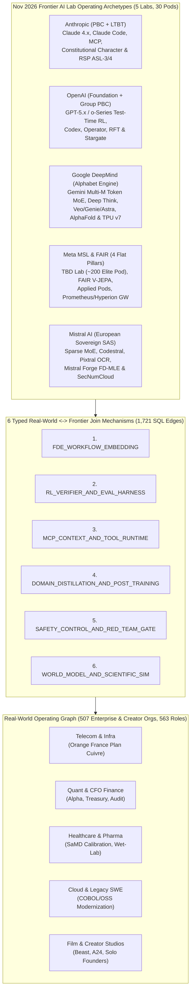
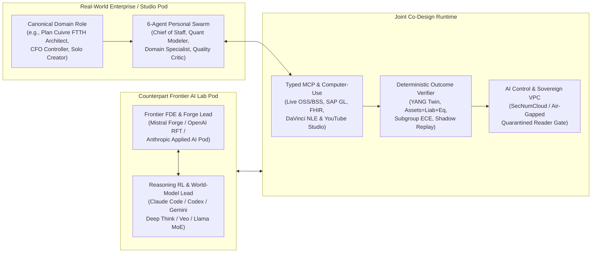

# Nov 2026 Frontier AI Labs & Real-World Enterprise Bridge Report

> [!IMPORTANT]
> **Executive Governing Thought**: By November 2026, the organizational divide between **what real-world enterprises and creators try to automate** (`512` organizations, `563` operating roles in [org_knowledge_base.db](file:///home/pakmingw/.gemini/antigravity/scratch/org_meta_prompt_db/data/org_knowledge_base.db)) and **how the five leading Frontier AI Labs organize to build intelligence** (**Anthropic**, **OpenAI**, **Google DeepMind**, **Meta Superintelligence Labs / FAIR**, and **Mistral AI**) is no longer a model-selection problem—it is a **systems, verifier, and pod-topology join problem**.
>
> Naive enterprise "prompt-and-vector-RAG wrappers" fail in production because foundation models alone lack **deterministic domain outcome verifiers**, **typed state/action harnesses (MCP & Computer-Use)**, **sovereign unit-economic distillation**, and **defense-in-depth AI Control**. Phase 16 bridges both worlds directly inside SQLite (`579` canonical roles, `60` tools, `30` frontier lab pods, `22` cross-industry bridges across `16/16` macro industries, and `1,721` relational `role_frontier_joins` achieving `100%` coverage across every real-world role).

---

## 1. How the 5 Frontier AI Labs Organize Work (November 2026)

Unlike traditional Fortune 500 functional silos, Nov 2026 Frontier AI Labs organize around **tightly coupled Pretraining → Verifier Post-Training → Disaggregated Silicon Serving → Forward-Deployed Engineering (FDE) pods**, where Research Engineers and Domain Verifier Architects share the same cluster telemetry and ship loops.



### Comparative Matrix of the 5 Frontier AI Labs (`frontier_ai_labs`)

| Frontier AI Lab | Corporate & Fiduciary Structure | Internal Pod Architecture (`6` Pods Each) | Signature Models, Harnesses & Compute Substrate | Safety Gate & Enterprise GTM Motion |
| :--- | :--- | :--- | :--- | :--- |
| **Anthropic** (`lab_anthropic`, Rank `508`) | Delaware PBC + independent **Long-Term Benefit Trust** holding Class T shares to enforce RSP safety gates | Pretraining Scaling; `Claude Code` & Computer-Use RL; Constitutional Character & Mech-Interp; Multi-Cloud KV Infra; `MCP` & Labs Incubation; Applied Enterprise FDE | `Claude 4.x` Opus/Sonnet/Haiku, `Claude Code`, open `MCP` standard; AWS Trainium2/3 + Google TPU + NVIDIA Blackwell with prompt caching | **RSP `ASL-3` / `ASL-4`** CBRN/cyber/autonomy containment + sparse autoencoder circuit audits; Applied AI FDE pods building production MCP & SWE harnesses |
| **OpenAI** (`lab_openai`, Rank `509`) | **OpenAI Foundation** Nonprofit + **OpenAI Group PBC** + Board Safety & Security Committee veto authority | Unified Multimodal Foundations; Test-Time Compute & `Codex` RL; Preparedness & Model Spec; `Stargate` GW Infra; `Responses API` & `ChatGPT Work`; Enterprise `RFT` Forge | `GPT-5.x` unified series, `o-series` verifiers, `Codex` cloud SWE, `Deep Research`, `Operator`; multi-GW `Stargate` clusters + custom ASICs | **Preparedness Framework v2** + **Deliberative Alignment** over public Model Spec + CoT monitorability; FDE pods co-authoring custom **Reinforcement Fine-Tuning (`RFT`)** graders |
| **Google DeepMind** (`lab_google_deepmind`, Rank `510`) | Unified Alphabet research-to-product engine under CEO Demis Hassabis & CTO Koray Kavukcuoglu + RSC | `Gemini` Multi-M-Token MoE; `Deep Think` & `AlphaEvolve` RL; `Veo`/`Genie`/`Astra` World Models; TPU `Ironwood` & `Pathways`; `FSF` & AI Control; `AlphaFold` & Vertex FDE | `Gemini 3.x` Pro/Ultra/Flash/Deep Think, `Veo`, `Genie`, `Project Astra`, `AlphaFold 3`; optical-switched **TPU v6e/v7 Ironwood** + `Pathways` | **Frontier Safety Framework (`FSF`)** Critical Capability Levels + **AI Control** sandboxes + `SynthID`; Google Cloud Vertex AI `Agent2Agent` + MCP customer pods |
| **Meta MSL & FAIR** (`lab_meta_msl`, Rank `511`) | 4 flat pillars under CAIO Alexandr Wang: **TBD Lab** (~200-person core pod), **FAIR**, **Products/Applied** (Nat Friedman), **MSL Infra** (Aparna Ramani) | `TBD Lab` Frontier Core; Expert Rubric & Self-Play RL; `FAIR` `V-JEPA 2` & Open Science; `Prometheus`/`Hyperion` GW & `PyTorch`; Applied/Wearables & `Llama`; `CyberSecEval` & Guard | `TBD Lab` frontier reasoning (`Muse`), `Llama` Sparse MoE open-weight family, `V-JEPA 2` latent world models, `DINOv3`; 1–5GW `Prometheus` & `Hyperion` clusters | **Meta Frontier AI Framework** marginal-risk gating + `Llama Guard` / `CyberSecEval`; zero-egress on-prem open-weight sovereignty & `TorchTune` distillation |
| **Mistral AI** (`lab_mistral_ai`, Rank `512`) | Independent French SAS led by Arthur Mensch, Guillaume Lample & Timothee Lacroix (`EU AI Act` + `SecNumCloud`) | Core Science Sparse MoE; `Codestral` / `Magistral` / `Pixtral` RL; **Mistral Forge FD-MLE**; `Mistral Compute` Sovereign Appliances; `Le Chat Enterprise` MCP; EU AI Act Evals | `Mistral Large`, `Magistral`, `Codestral`, `Pixtral` & `Mistral OCR`, `Ministral` edge; decarbonized French nuclear/hydro GPU clusters + air-gapped vLLM appliances | **EU AI Act GPAI** systemic-risk compliance + **ANSSI `SecNumCloud`** air-gapped isolation; embedded FD-MLEs running **Mistral Forge** custom pretraining/DPO on client data |


---

## 2. The 16 Frontier AI Lab Canonical Roles, 5 Tools & 2 Bridge Superhumans

Seeded via [seed_frontier_labs.py](file:///home/pakmingw/.gemini/antigravity/scratch/org_meta_prompt_db/orgprompt/db/seed_frontier_labs.py), Phase 16 adds **5 specialized Frontier Lab Vertical Tools** (`tools` → `60`) and **16 Nov 2026 Frontier Lab Canonical Roles** (`canonical_roles` → `579`), each complete with a `>= 6,000`-character 7-section System Prompt, `5` day-to-day workflows, `11` dual-layer tools, and an acyclic `6`-agent Personal Subagent Swarm.

### 2.1 The 5 Frontier Lab Vertical Tools (`tools`)
1. `tool_agentic_rl_gym_verifiers` — **Agentic RL Gyms, SWE Sandboxes & Outcome Verifier Harnesses** (containerized multi-repo execution graders, formal Lean 4/solver verifiers, reward-hacking monitors).
2. `tool_mcp_context_computer_use_runtime` — **Model Context Protocol (MCP), Computer-Use & Browser/OS Action Harnesses** (typed read/canary-write tool buses, GUI action sandboxes, subagent context compaction).
3. `tool_disaggregated_kv_inference_stack` — **Disaggregated Prefill/Decode, Speculative Decoding & vLLM/SGLang/TensorRT-LLM Stack** (KV-cache prompt routing, FP8/INT4 quantization, TPU `Pathways` / GPU goodput telemetry).
4. `tool_frontier_eval_preparedness_suite` — **Frontier Capability Evals, ASL/Preparedness CBRN-Cyber Gates & Inspect Harness** (UK AISI `Inspect`, contamination forensics, dual-privilege AI Control sandboxes).
5. `tool_fde_custom_posttraining_forge` — **Forward-Deployed Enterprise Post-Training, Distillation & Sovereign VPC Forge** (`Mistral Forge`, OpenAI `RFT`, `TorchTune` teacher-student MoE distillation inside air-gapped enclaves).

### 2.2 The 16 Nov 2026 Frontier AI Lab Canonical Roles (`canonical_roles`)

| Pod Cluster | Canonical Role Slug | Role Title & Core Frontier Mandate |
| :--- | :--- | :--- |
| **Reasoning & Agentic RL** | `frontier_test_time_compute_reasoning_rl_lead` | *Principal Reasoning, Test-Time Compute & Verifier RL Scientist* — Outcome-reward RL, parallel tree search, anti-reward-hacking |
| **Reasoning & Agentic RL** | `frontier_agent_post_training_computer_use_lead` | *Agentic Post-Training & Computer-Use Environment Lead* — Long-horizon browser/OS/terminal trajectories & state recovery |
| **Reasoning & Agentic RL** | `frontier_coding_agent_swe_harness_architect` | *Principal AI Coding Agent & Autonomous SDLC Harness Architect* — Multi-repo SWE gyms, AST diffing, differential shadow replay |
| **Reasoning & Agentic RL** | `frontier_context_engineering_mcp_architect` | *Staff Context Engineering & Model Context Protocol (MCP) Ecosystem Architect* — Typed MCP state servers, RBAC & context compaction |
| **Reasoning & Agentic RL** | `frontier_synthetic_data_curriculum_selfplay_lead` | *Principal Synthetic Data, Rubric Verifier & Self-Play Curriculum Lead* — PhD rubric grading & adversarial curriculum synthesis |
| **World Models & Infra** | `frontier_multimodal_world_model_sim_architect` | *Principal Multimodal World-Model, Native Audio-Video & Embodied Sim Lead* — 3D/video physics priors (`Veo`/`Genie`/`V-JEPA 2`) |
| **World Models & Infra** | `frontier_long_context_moe_architecture_lead` | *Principal Sparse MoE, Hybrid Linear-Attention & Scaling Laws Architect* — Multi-million-token recall & intelligence-per-FLOP |
| **World Models & Infra** | `frontier_disaggregated_inference_kv_systems_lead` | *Principal Disaggregated Inference, Speculative Decoding & KV-Cache Architect* — Prefill/decode split & sub-50ms fleet FinOps |
| **World Models & Infra** | `frontier_gigawatt_cluster_tpu_gpu_codesign_lead` | *Principal Gigawatt AI Cluster, Network Topology & Silicon Co-Design Lead* — 1–5GW optical/RoCE fabrics, Trainium/TPU/Blackwell MFU |
| **World Models & Infra** | `frontier_research_engineer_orchestration_lead` | *Staff Frontier Research Engineer (RE) & Multi-Agent Fleet Orchestrator* — Stateful multi-agent DAGs & async background sandboxes |
| **Alignment, Control & Evals** | `frontier_model_character_spec_alignment_lead` | *Model Character, Model Spec & Constitutional Alignment Lead* — Deliberative alignment, epistemic calibration & anti-sycophancy |
| **Alignment, Control & Evals** | `frontier_asl_preparedness_control_evaluator` | *Frontier Preparedness, ASL Bio/Cyber Autonomy & AI Control Lead* — `ASL-3`/`ASL-4` & `FSF` gates, prompt-injection dual-privilege control |
| **Alignment, Control & Evals** | `frontier_eval_science_benchmark_contamination_lead` | *Staff Frontier Evaluation Science, Contamination Forensics & Human-Preference Lead* — Subgroup ECE calibration & de-contaminated evals |
| **FDE, Forge & Science** | `frontier_forward_deployed_ai_engineer_lead` | *Lead Forward-Deployed AI Engineer (FDE) & Enterprise Workflow Pod Lead* — Customer-embedded MCP/RFT/Swarm production re-engineering |
| **FDE, Forge & Science** | `frontier_enterprise_distillation_forge_lead` | *Principal Enterprise Model Customization, Domain RL & Distillation Lead* — Teacher-to-student Sparse MoE distillation & sovereign DPO |
| **FDE, Forge & Science** | `frontier_ai_for_science_discovery_lead` | *Principal AI for Scientific Discovery, Biology & Materials Architect* — Equivariant surrogates, `AlphaFold` wet-lab loops & AC-OPF/CFD |

In addition, **2 Polymathic Frontier Bridge Superhuman Profiles** (`> 53,000` chars each) are persisted in `superhuman_role_profiles`:
- `superhuman_frontier_fde_enterprise_bridge_architect` (`53,881` chars) — Fuses Palantir/Mistral/Anthropic FDE scar tissue with MCP architecture, RFT verifiers, and CFO ROIC discipline.
- `superhuman_frontier_post_training_verifier_chief` (`54,766` chars) — Unites test-time compute RL, formal solver/CI outcome graders, and contamination forensics to eliminate reward hacking.

---

## 3. How the Real World Joins to Frontier Labs (`orgprompt.frontier`)

Implemented in [join_engine.py](file:///home/pakmingw/.gemini/antigravity/scratch/org_meta_prompt_db/orgprompt/frontier/join_engine.py) and [catalog_bridges.py](file:///home/pakmingw/.gemini/antigravity/scratch/org_meta_prompt_db/orgprompt/frontier/catalog_bridges.py), the relational join layer connects **100% of our `563` non-`frontier_*` real-world roles** (`1,689` enterprise-to-frontier edges + `32` cross-lab edges = **`1,721` total `role_frontier_joins` rows**, `0` broken FKs) across **6 Typed Join Mechanisms**:

| Join Mechanism (`role_frontier_joins`) | SQL Edges | Why Naive Enterprise LLM Wrappers Fail | What the Joined Frontier Lab Counterpart Supplies |
| :--- | ---: | :--- | :--- |
| `RL_VERIFIER_AND_EVAL_HARNESS` | `446` | Unverified text completions violate double-entry accounting, Kirchhoff AC power flow, CI tests, or subgroup calibration | Deterministic Python/SQL/solver/CI outcome graders driving RFT & test-time compute verification |
| `DOMAIN_DISTILLATION_AND_POST_TRAINING` | `430` | Giant frontier reasoning calls cost \$5–\$25/M tokens, breach `<50ms` retail/edge SLAs, or violate air-gapped sovereignty | Teacher-trace Sparse MoE distillation (`Mistral Forge` / `Llama` / `Flash`) inside sovereign VPCs |
| `FDE_WORKFLOW_EMBEDDING` | `254` | Bolting a chat sidebar onto broken 15-step human handoffs produces "AI pilot theater" with zero EBITDA impact | Embedded FDEs pairing with each role's **6-Agent Personal Swarm** to re-architect end-to-end DAGs |
| `MCP_CONTEXT_AND_TOOL_RUNTIME` | `232` | Chunked static vector-RAG goes stale, loses cross-clause bindings, and cannot actuate legacy portals/NLEs/OSS | Typed read/canary-write **MCP** servers + **Computer-Use** GUI harnesses with RBAC audit logs |
| `SAFETY_CONTROL_AND_RED_TEAM_GATE` | `195` | Agents reading untrusted emails/tickets/SIEM logs suffer indirect prompt injection and hallucinate legal commitments | **AI Control** quarantined/privileged dual-model split, `ASL-3`/EU AI Act red-teaming & calibrated abstention |
| `WORLD_MODEL_AND_SCIENTIFIC_SIM` | `164` | 1D text tokens lack 3D rigid/deformable kinematics, biomolecular all-atom physics, and raw video timeline pacing | Action-conditioned world models (`Veo`/`Genie`/`V-JEPA 2`) & equivariant wet-lab/CFD surrogates |


### 3.1 Five Concrete SQL-Joined Co-Design Blueprints (`real_world_to_frontier_bridges`)



1. **Telecommunications — `Orange France` (`Plan Cuivre` FTTH Copper Decommissioning & Sovereign 5G OSS/BSS)**:
   - *Real-World Roles Joined*: `principal_ftth_copper_decommissioning_architect_plan_cuivre`, `chief_orange_business_evolution_platform_architect`, `orange_cyberdefense_principal_soc_anssi_compliance_lead` ([orange_france_frontier_lab_bridge.md](file:///home/pakmingw/.gemini/antigravity/scratch/org_meta_prompt_db/artifacts/frontier_labs/orange_france_frontier_lab_bridge.md)).
   - *Why Naive Wrappers Fail*: Generic RAG hallucinates civil-duct splice topologies (`18–25%` wasted field-truck rolls), cannot run NETCONF/YANG pre-checks, and violates ANSSI `SecNumCloud` telemetry sovereignty.
   - *Frontier Lab Join Recipe*: **Mistral AI** (`pod_mistral_forge_fde_enterprise` + `Pixtral` civil-map OCR + Sovereign Appliance) + **Anthropic** (`Claude Code` legacy mediation refactoring + Nokia/Ericsson SMO MCP gates), verified inside a digital-twin YANG simulator before any live network write.
2. **Quantitative Markets & CFO Corporate Finance — Alpha Contamination & 48-Hour Statutory Close**:
   - *Real-World Roles Joined*: `fin_principal_quant_strategist`, `fin_chief_risk_officer`, `fin_chief_financial_officer`, `fin_corporate_controller`.
   - *Why Naive Wrappers Fail*: Foundation models leak post-cutoff market knowledge into historical backtests and violate double-entry ledger conservation (`Assets = Liabilities + Equity`) on intercompany FX eliminations.
   - *Frontier Lab Join Recipe*: **OpenAI** (`pod_openai_fde_rft_enterprise` custom Python/SQL double-entry & Sharpe RFT graders) + **Anthropic** (`frontier_eval_science_benchmark_contamination_lead` temporal point-in-time MCP data fences) + air-gapped **Meta `Llama`** / **Mistral** distilled inference.
3. **Healthcare & Biopharma — SaMD Subgroup Calibration & Closed-Loop Wet-Lab Discovery**:
   - *Real-World Roles Joined*: `health_chief_medical_officer`, `clin_dir_biostatistics_data_mgmt`, `pharma_chief_scientific_officer`, `pharma_principal_pharmacometrics_modeler`.
   - *Why Naive Wrappers Fail*: Aggregate `0.91` AUROC masks severe Simpson's-paradox under-triage in immunocompromised cohorts, while text-only models hallucinate unexpressible protein sequences.
   - *Frontier Lab Join Recipe*: **Google DeepMind** (`Gemini` multi-million-token longitudinal FHIR/DICOM timelines + `AlphaFold 3` wet-lab active learning) + **Anthropic** (`ASL-3` biosecurity screening + subgroup conformal calibration verifiers enforcing abstention under OOD lab drift).
4. **Hyperscale Cloud & Legacy Software Modernization — Differential Shadow-Replay SWE Gyms**:
   - *Real-World Roles Joined*: `infra_principal_distributed_systems_eng`, `infra_staff_site_reliability_engineer`, `infra_staff_database_reliability_engineer`.
   - *Why Naive Wrappers Fail*: File-by-file COBOL/Java/PL-SQL translation breaks cross-module call graphs and introduces silent fixed-point rounding bugs (\$0.01 drift across millions of settlements).
   - *Frontier Lab Join Recipe*: **Anthropic** (`pod_anthropic_claude_code_computer_use`), **OpenAI** (`Codex` cloud containers), and **Mistral** (`Codestral`) wired to AST call-graph MCP indexers and differential shadow-traffic replay verifiers requiring `100%` golden-output parity.
5. **Indie Film & YouTube Creator Studios — `Beast Industries`, `A24` & 1-to-10x Solo Founder Leverage**:
   - *Real-World Roles Joined*: `creator_youtube_head_of_ideation_packaging`, `creator_lead_retention_video_editor`, `creator_solo_founder_one_person_media_studio`, `media_indie_film_line_producer_upm` ([beast_industries_frontier_lab_bridge.md](file:///home/pakmingw/.gemini/antigravity/scratch/org_meta_prompt_db/artifacts/frontier_labs/beast_industries_frontier_lab_bridge.md)).
   - *Why Naive Wrappers Fail*: Prompted scripts produce flat corporate intros that destroy `0–30s` viewer retention (`AVD`) and cannot inspect multi-hour raw camera/audio pacing or OpenUSD lighting passes.
   - *Frontier Lab Join Recipe*: **Google DeepMind** (native multi-hour raw video/audio timeline ingestion for retention drop-off diagnosis + `Veo` previz + `SynthID` clean IP provenance) + **Anthropic** (`DaVinci Resolve` / `YouTube Studio` MCP servers) + **Meta/OpenAI** rubric-trained packaging/hook critics, enabling a \$5K-budget solo creator to operate with the packaging rigor of a `300`-person studio.

---

## 4. CLI (`orgprompt frontier`) & Antigravity Skill Quick Reference

Dual-installed in `~/.gemini/config/skills/org-frontier-lab-enterprise-bridge/` and [.agents/skills/org-frontier-lab-enterprise-bridge/SKILL.md](file:///home/pakmingw/.gemini/antigravity/scratch/org_meta_prompt_db/.agents/skills/org-frontier-lab-enterprise-bridge/SKILL.md) and wired into [cli.py](file:///home/pakmingw/.gemini/antigravity/scratch/org_meta_prompt_db/orgprompt/cli.py):

```bash
cd /home/pakmingw/.gemini/antigravity/scratch/org_meta_prompt_db

# 1. List all 5 Nov 2026 Frontier AI Labs and their 30 internal operating pods
python3 -m orgprompt.cli frontier labs

# 2. Inspect a specific Frontier Lab's governance, research loop, safety gates & 6 pods
python3 -m orgprompt.cli frontier inspect-lab anthropic
python3 -m orgprompt.cli frontier inspect-lab mistral_ai --format json

# 3. Join any of the 579 canonical roles to its counterpart Frontier Lab roles & mechanisms
python3 -m orgprompt.cli frontier join-role principal_ftth_copper_decommissioning_architect_plan_cuivre --company "Orange France"
python3 -m orgprompt.cli frontier join-role creator_solo_founder_one_person_media_studio --company "Beast Industries"

# 4. Generate a full company-wide Enterprise <-> Frontier Lab co-design blueprint
python3 -m orgprompt.cli frontier join-company "Orange France" --output artifacts/frontier_labs/orange_france_frontier_lab_bridge.md

# 5. Bridge any arbitrary problem statement via HybridSearch + SQL Frontier Pod Join
python3 -m orgprompt.cli frontier bridge-problem \
  --problem "Modernize legacy COBOL/PL-SQL settlement monolith with zero double-spend regressions" \
  --format markdown
```
