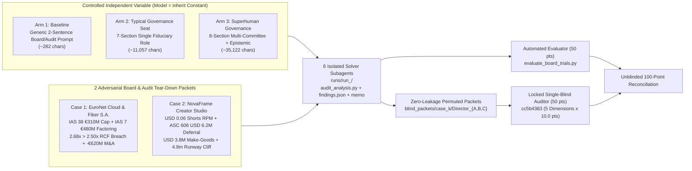

# Fiduciary Governance & Independent Audit Taxonomy Tier (`orgprompt.governance`) — Controlled 3-Arm Single-Blind Benchmark Report

> [!IMPORTANT]
> **Headline Empirical Finding (`2 Cases × 3 Arms = 6 Isolated Single-Blind Trials`, `Model: inherit` Held Constant)**:  
> Across two adversarial Quarterly Board & Audit Tear-Down Packets—**Case 1: Public Cloud & Telecom Enterprise (*EuroNet Cloud & Fiber S.A.*)** and **Case 2: Venture Indie Film & Creator Media Studio (*NovaFrame Studios & Channels, Inc.*)**—**both dedicated Fiduciary Governance arms (`Arm 2: Typical Governance Role` and `Arm 3: Superhuman Governance Role`) decisively outperformed `Arm 1: Baseline` (`0/2` wins, `Rank #3` dead last on every case)**:
> - **Arm 2 (`Typical Governance Role`, `~11,057` chars)**: **`97.25 / 100`** (`47.25 / 50` blind + `50.00 / 50` objective; **`+4.75` pts / `+11.18%` relative uplift** on the 50-pt blind rubric over `Baseline`; `Rank #1` on Case 1).
> - **Arm 3 (`Superhuman Governance Role`, `~35,122` chars)**: **`96.75 / 100`** (`46.75 / 50` blind + `50.00 / 50` objective; **`+4.25` pts / `+10.00%` relative uplift** over `Baseline`; **`Rank #1` on cross-domain Venture/Audit Case 2**, achieving **#1 across all arms** on **`d3` Multi-Committee & Incentive Governance (`9.75 / 10`, `+2.00` pts over Baseline)** and **`d4` AI Swarm & Operating Value Creation (`9.50 / 10`)**).
> - **Arm 1 (`Baseline Generic Board/Auditor Prompt`, `~282` chars)**: **`92.50 / 100`** (`42.50 / 50` blind; `Rank #3` on both cases), suffering severe governance omissions (`d3 = 7.75 / 10`: zero closed *in-camera* assurance sessions excluding CEO/CFO in either case, zero executive bonus clawback in Case 2, and a material `-\$3.80M` GAAP EBITDA classification error in Case 2 `findings.json`).

---

## 1. Taxonomy Architecture & Single-Blind Experimental Design

Why must Board Directors and Independent Auditors live in a **dedicated Fiduciary Oversight Taxonomy Tier** ([orgprompt/governance/](file:///home/pakmingw/.gemini/antigravity/scratch/org_meta_prompt_db/orgprompt/governance/), [SKILL.md](file:///home/pakmingw/.gemini/config/skills/org-board-and-auditor-governance/SKILL.md)) sitting **above and outside** `canonical_roles`? Operating executives execute inside management's hierarchy under the CEO; Board Members and Statutory/Forensic/Strategic Auditors hold the CEO & CFO accountable (`OVERSEES_AND_ADVISES`, `CHALLENGES_CAPITAL_ALLOCATION`, `ATTESTS_FINANCIAL_CONTROLS`, `AUDITS_STRATEGIC_AND_AI_PERFORMANCE`, `GATES_COMPENSATION_AND_SUCCESSION`).

- **`governance_roles` (`18` Roles)**: `6` Universal Fiduciary & External Audit seats + `12` Industry-Specialist Directors & Auditors (`10,372–11,101` chars, 7-Section Fiduciary Prompts), wired via `22` `industry_board_compositions` (`16` Public Enterprise + `6` Venture/Creator slates) and `72` `governance_oversight_edges`.
- **`superhuman_governance_profiles` (`3` Flagship Archetypes, `34,004–35,151` chars)**: [superhuman_gov_capital_allocation_board_director.md](file:///home/pakmingw/.gemini/antigravity/scratch/org_meta_prompt_db/artifacts/governance_roles/superhuman_gov_capital_allocation_board_director.md), [superhuman_gov_forensic_strategic_auditor.md](file:///home/pakmingw/.gemini/antigravity/scratch/org_meta_prompt_db/artifacts/governance_roles/superhuman_gov_forensic_strategic_auditor.md), and [superhuman_gov_media_creator_board_partner.md](file:///home/pakmingw/.gemini/antigravity/scratch/org_meta_prompt_db/artifacts/governance_roles/superhuman_gov_media_creator_board_partner.md).

### Methodological Controls & Quarantine Verification
1. **1-to-1 Anchor-to-Superhuman Pairing**: Case 1 paired `gov_capital_allocation_value_director` (`Arm 2`) directly against its multi-committee expansion `superhuman_gov_capital_allocation_board_director` (`Arm 3`). Case 2 paired `gov_media_creator_venture_board_partner` (`Arm 2`) directly against `superhuman_gov_media_creator_board_partner` (`Arm 3`).
2. **Zero Prompt-Fingerprint Leakage**: [evaluate_board_trials.py](file:///home/pakmingw/.gemini/antigravity/scratch/org_meta_prompt_db/benchmarks/governance_eval/evaluate_board_trials.py) stripped all role slugs, `Superhuman`/`OKG` labels, and `SCREAMING_SNAKE_CASE` template enums (`0` fingerprint leaks across all `18` blind files) and shuffled `Director_A/B/C` per case. Independent Auditor `cc5b4383-4bd4-44cc-beb5-fb19a5006b78` attested strict quarantine prior to locking [locked_blind_auditor_scores.json](file:///home/pakmingw/.gemini/antigravity/scratch/org_meta_prompt_db/benchmarks/governance_eval/blind_packets/locked_blind_auditor_scores.json).

---

## 2. Master Unblinded Results (`100` Points = `50` Objective + `50` Blind Auditor)

| Case & Governance Pairing | Blind ID | Experimental Arm | Trial Run | Prompt Chars | Output Bytes | Objective (`50`) | Blind Auditor (`50`) | Combined (`100`) | Blind Rank |
| :--- | :---: | :--- | :---: | ---: | ---: | ---: | ---: | ---: | :---: |
| **Case 1: EuroNet Cloud & Fiber** (`Enterprise`) | `Director_B` | `Arm 1: Baseline` | `run_daa55402` | `305` | `25,704` | `50.0` | `43.5` | **`93.5`** | `#3` |
| **Case 1: EuroNet Cloud & Fiber** (`Enterprise`) | `Director_A` | **`Arm 2: Typical Gov`** | `run_affe7ff5` | `11,101` | `29,450` | `50.0` | **`48.0`** | **`98.0`** | **`#1`** |
| **Case 1: EuroNet Cloud & Fiber** (`Enterprise`) | `Director_C` | `Arm 3: Superhuman Gov` | `run_6b9324ad` | `35,092` | `25,528` | `50.0` | `45.5` | **`95.5`** | `#2` |
| **Case 2: NovaFrame Studio** (`Venture/Creator`) | `Director_B` | `Arm 1: Baseline` | `run_37023646` | `258` | `22,963` | `50.0` | `41.5` | **`91.5`** | `#3` |
| **Case 2: NovaFrame Studio** (`Venture/Creator`) | `Director_C` | `Arm 2: Typical Gov` | `run_64a3dec9` | `11,013` | `21,884` | `50.0` | `46.5` | **`96.5`** | `#2` |
| **Case 2: NovaFrame Studio** (`Venture/Creator`) | `Director_A` | **`Arm 3: Superhuman Gov`** | `run_b797d7d7` | `35,151` | `26,809` | `50.0` | **`48.0`** | **`98.0`** | **`#1`** |

### Aggregate Performance & 5-Dimension Rubric Decomposition

| Experimental Arm | Mean Prompt Chars | Mean Output Bytes | Obj (`50`) | `d1` Forensic GAAP/IFRS | `d2` ROIC & Solvency | `d3` Multi-Committee & Clawback | `d4` AI Swarm & Ops Levers | `d5` Falsifiable Gates | Blind Mean (`50`) | Combined Mean (`100`) | `#1` Wins |
| :--- | ---: | ---: | ---: | ---: | ---: | ---: | ---: | ---: | ---: | ---: | :---: |
| **Arm 1: Baseline** | `281.5` | `24,334` | `50.00` | `8.75` | `9.00` | `7.75` | `8.75` | `8.25` | `42.50` | **`92.50`** | `0 / 2` |
| **Arm 2: Typical Governance** | `11,057.0` | `25,667` | `50.00` | **`9.50`** | **`9.75`** | `9.50` | `9.25` | **`9.25`** | **`47.25`** | **`97.25`** | **`1 / 2`** |
| **Arm 3: Superhuman Governance** | `35,121.5` | `26,169` | `50.00` | `9.25` | `9.00` | **`9.75`** | **`9.50`** | **`9.25`** | **`46.75`** | **`96.75`** | **`1 / 2`** |
| **Typical Gov vs. Baseline** | `+10,775.5` | `+1,333 B` | `+0.00` | **`+0.75`** | **`+0.75`** | **`+1.75`** | **`+0.50`** | **`+1.00`** | **`+4.75` (`+11.2%`)** | **`+4.75`** | `+50%` |
| **Superhuman Gov vs. Baseline** | `+34,840.0` | `+1,835 B` | `+0.00` | **`+0.50`** | `+0.00` | **`+2.00`** | **`+0.75`** | **`+1.00`** | **`+4.25` (`+10.0%`)** | **`+4.25`** | `+50%` |

---

## 3. Forensic Case-by-Case Breakdown: What Separated Fiduciary Governance from Baseline

### Case 1: EuroNet Cloud & Fiber S.A. (`Public Cloud & Telecom Enterprise`)
- **Ground-Truth Traps**: `€310.0M` routine OSS/BSS & copper repair OpEx capitalized into `eCapEx` (`IAS 38.57` override, inflating EBITDA to `€2,260.0M` / `+9.4%` YoY vs. `€1,950.0M` / `-5.61%` true while FCF fell `-14.0%` to `€559.0M` and `€399.0M` underlying); `€480.0M` novated 180-day supplier reverse factoring (`IAS 7 / IFRS 7`) pushing true Net Debt/EBITDA from `2.10x` to **`2.68x` (`> 2.50x` Senior RCF covenant breach pre-M&A)**; `€1,800.0M` *Project Alpine* M&A (`ROIC 4.20% < 7.80% WACC`, **`NPV = -€620.23M`** headline / `-€825.23M` all-in with `IAS 19` pension & severance) vs. `€400.0M` internal AI GIS Copper-Decommissioning + Agentic SOC/SD-WAN Swarms (**`38.47%` IRR, `+€471.15M` NPV**, curing RCF leverage to `2.41x` in 12 months).
- **Typical Governance (`Director_A` / `run_affe7ff5` — `98.0 / 100`, Blind `48.0 / 50`, Rank `#1`)**:
  - Delivered exact sub-component DCF math (`€284.95M + €894.82M = €1,179.77M` PV), both headline (`-€64.80M/yr`) and all-in (`-€80.80M/yr` on `€2,005M`) Economic Profit destruction, Year-1 post-tax negative carry (`-€50.48M`), a calibrated **4-quarter RCF waiver (`2.75x` cap)** matching the `Q3 (2.49x) -> Q4 (2.41x)` cure curve, the direct causal link showing the `€400M` internal AI/copper backlog eliminates the exact `€125M + €185M = €310M` Note 7 maintenance burden, Day-5 CEO/CFO-excluded *in-camera* sessions across 5 assurance leads, `>15%` tranche draw-freeze gates, and `100%` forfeiture of the `€18.40M` cliff bonus pool.
- **Superhuman Governance (`Director_C` / `run_6b9324ad` — `95.5 / 100`, Blind `45.5 / 50`, Rank `#2`)**:
  - Tied `Director_A` at **`9.5 / 10`** on both Multi-Committee Governance (`d3`) and AI Swarm Value Creation (`d4`), uniquely adding a **36-month Big-4 capitalization journal lookback**, **DACH works-council transition covenants**, a realistic `750`-exchange Year-1 physical power-down pace, and a conservative **3.5-year depreciation guardrail on AI compute hardware**. Trailed `Director_A` solely due to requesting a 2-quarter RCF waiver (`Gate 1`) while projecting Q2 leverage at `2.58x` (`> 2.50x`), creating a one-quarter waiver mismatch prior to Q3 cure.
- **Baseline (`Director_B` / `run_daa55402` — `93.5 / 100`, Blind `43.5 / 50`, Rank `#3`)**:
  - Strong `IAS 16.12` + `IAS 38.57` accounting citations, but **omitted closed *in-camera* sessions** with Controller/Internal Audit/CISO/Treasurer (`d3 = 8.0`), issued **no license-revocation directive** for the `12,400` copilot seats, unrealistically compressed all `1,450` copper exchange cutovers into Year 1, and double-counted the `€18.4M` forfeited bonus pool on top of `€399.0M` FCF.

### Case 2: NovaFrame Studios & Channels, Inc. (`Venture Indie Film & Creator Media Studio`)
- **Ground-Truth Traps**: `140.0M` monthly views (`+85.2%` YoY) driven `86.79%` (`121.5M`) by `\$0.06` RPM syndicated Shorts (`\$7.29k/mo`, `0.14%` sub conversion) while Core Long-Form views fell `-44.94%`, `CTR` collapsed `8.4% -> 3.9%`, `AVD` fell `54.0% -> 36.0%`, and core sponsor renewals decayed **`-31.0%`**; `\$6.20M` premature upfront 2027 retainer recognition (`ASC 606-10-25`) + `\$3.80M` unbooked make-good & cash-rebate liabilities (`ASC 606-10-32 / ASC 450-20`), restating GAAP Revenue `\$18.40M -> \$12.20M` and GAAP EBITDA `+\$1.15M -> -\$8.85M`; `\$12.0M` fixed 2-yr talent MGs + `\$4.5M` LA soundstage pushing burn to `\$1,479.17k/mo` (**`4.80` months cash runway** on `\$7.10M` cash) vs. *Blumhouse* micro-budget kill-gate + *MrBeast* packaging pre-validation + AI rough-cut/6-language dubbing swarm (**`-48.11%` episode cost `\$185k -> \$96k`** and **`22.03` months net post-rebate runway -> `+\$155.0k/mo` cash-flow positive post-Q2**).
- **Superhuman Governance (`Director_A` / `run_b797d7d7` — `98.0 / 100`, Blind `48.0 / 50`, Rank `#1`, `d3 = 10.0 / 10.0`)**:
  - Fused Venture Studio Board Partner + Audit Chair + Capital Allocation + Brand Equity + Strategic AI Auditor: delivered explicit debit/credit journal entries (`\$0.60M` Accrued Rebate Payable vs. `\$3.20M` Make-Good Contract Liability), exposed production CPM surge (`\$16.90 -> \$40.00` vs. `\$18.50` RPM = `-53.75%` AdSense margin), modeled **5 cash/runway stress scenarios** (`18.73m/17.14m` baseline; `4.80m` expansion; `4.39m` post-rebate; `3.60m` with 19-slot inventory cannibalization; `22.03m` net turnaround), and anchored governance in **`DGCL §141(a)` / *Caremark* oversight**, closed *in-camera* interviews (Controller, Line Producer/UPM, Packaging Lead, Brand Partnerships), weekly 13-week direct cash ledger, `>\$25k` dual-signatory lock, `\$4.50M` liquidity covenant floor, anti-synthetic-slop brand guardrail, and `100%` FY26 bonus clawback.
- **Typical Governance (`Director_C` / `run_64a3dec9` — `96.5 / 100`, Blind `46.5 / 50`, Rank `#2`)**:
  - Correctly restated GAAP EBITDA to `-\$8.85M`, proactively added an **`ASC 926` content-library capitalization ban** (`90%` 30-day YouTube view decay) + CPG/merch MOQ ban, capped future sponsor view guarantees at `<=70%` of trailing 90-day median organic views, and convened 5 *in-camera* sessions—trailing `Superhuman` by `1.5` pts on looser `\$50k` dual-signatory controls, omitting the weekly 13-week direct cash ledger, and omitting the `3.60m` slot-cannibalized stress case.
- **Baseline (`Director_B` / `run_37023646` — `91.5 / 100`, Blind `41.5 / 50`, Rank `#3`)**:
  - Materially misclassified GAAP EBITDA as `-\$5.05M` in `findings.json` (improperly excluding `\$3.80M` of incurred `ASC 606-10-32 / ASC 450-20` make-good liabilities from primary GAAP EBITDA, `d1 = 8.0`), **omitted all closed *in-camera* assurance interviews and omitted any executive bonus clawback or STI/LTI reform (`d3 = 7.5`)**, and omitted `ROIC` vs. `WACC` framing, liquidity floor covenants, and anti-slop AI guardrails.

---

## 4. Architectural Synthesis: Phase 13 Operating Roles vs. Phase 15 Fiduciary Governance Tier

> [!TIP]
> **Why Dedicated Fiduciary Governance Prompts (`Arm 2` & `Arm 3`) Both Crush Generic Prompting—And Where `Superhuman` Adds Peak Alpha**:
> 1. **Dedicated Fiduciary Separation (`orgprompt.governance`) Eliminates Executive Capture (`+1.75` to `+2.00` pts on `d3`)**: Unlike narrow operating roles in Phase 13 (`canonical_roles`, which execute *inside* functional silos), every `governance_roles` prompt (`Arm 2`, `97.25 / 100`) encodes structural independence—closed *in-camera* verification with the Controller/UPM/CISO excluding the CEO & CFO, Socratic denominator challenges, and incentive malus/clawback gates.
> 2. **Multi-Committee `Superhuman` Fusion Excels on Hybrid Creative-Operational + Forensic-Insolvency Seams (`Rank #1` on Case 2, `98.0 / 100`, `d3 = 10.0 / 10.0`)**: When a boardroom crisis spans creator-packaging psychology (*MrBeast/Blumhouse*), multi-standard `ASC 606 / ASC 450` journal entries, inventory-cannibalized cash physics, and Delaware *Caremark* insolvency duties, `SuperhumanGovernanceSynthesizer` (`Arm 3`) eliminates the blind spots of a single Venture Partner seat (`+1.5` pts over `Arm 2`, `+6.5` pts over `Baseline`).

---

## 5. Reproducibility & Verification Manifest

- **Governance SDK, Seeders & Skill**: [orgprompt/governance/](file:///home/pakmingw/.gemini/antigravity/scratch/org_meta_prompt_db/orgprompt/governance/), [SKILL.md](file:///home/pakmingw/.gemini/config/skills/org-board-and-auditor-governance/SKILL.md), [test_governance_board_auditors.py](file:///home/pakmingw/.gemini/antigravity/scratch/org_meta_prompt_db/tests/test_governance_board_auditors.py)
- **Benchmark Packets, Evaluator & Locked Blind Audit**: [setup_board_packets.py](file:///home/pakmingw/.gemini/antigravity/scratch/org_meta_prompt_db/benchmarks/governance_eval/setup_board_packets.py), [prepare_board_trials.py](file:///home/pakmingw/.gemini/antigravity/scratch/org_meta_prompt_db/benchmarks/governance_eval/prepare_board_trials.py), [evaluate_board_trials.py](file:///home/pakmingw/.gemini/antigravity/scratch/org_meta_prompt_db/benchmarks/governance_eval/evaluate_board_trials.py), [locked_blind_auditor_scores.json](file:///home/pakmingw/.gemini/antigravity/scratch/org_meta_prompt_db/benchmarks/governance_eval/blind_packets/locked_blind_auditor_scores.json), [unblinded_reconciliation.json](file:///home/pakmingw/.gemini/antigravity/scratch/org_meta_prompt_db/benchmarks/governance_eval/private_key/unblinded_reconciliation.json), [test_governance_benchmark_artifacts.py](file:///home/pakmingw/.gemini/antigravity/scratch/org_meta_prompt_db/tests/test_governance_benchmark_artifacts.py)
