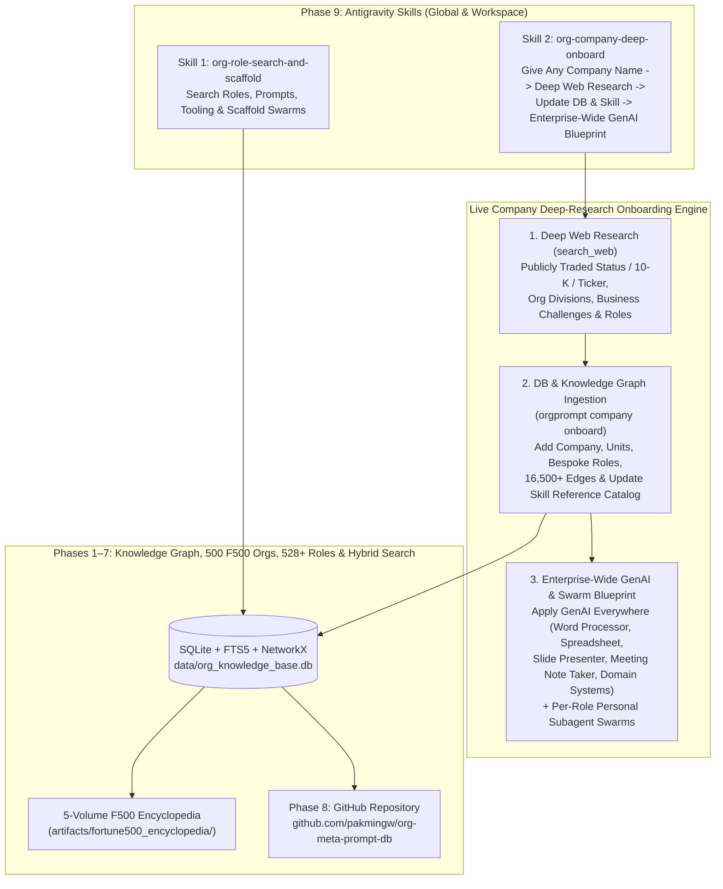
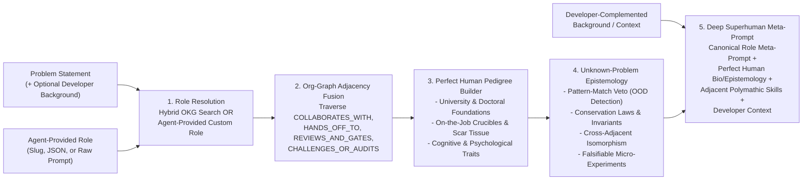
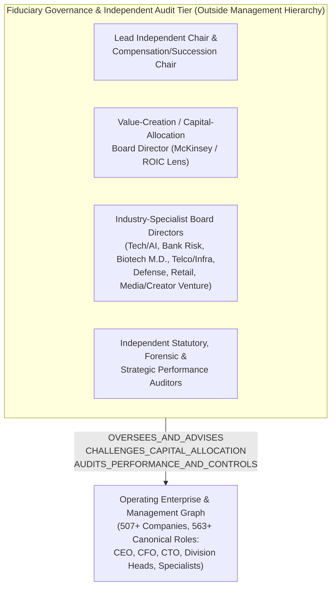

# Phased Implementation Plan: Global Organizational Taxonomy, Fortune 500 Knowledge Graph, Role Tooling, Subagent Swarms & Antigravity Skills

> [!IMPORTANT]
> **Core North Star**: Have a complete, empirically grounded model for **every Fortune 500 enterprise** (plus the ability to dynamically research and onboard **any new company on Earth** on demand) and **how every individual professional inside it works day-to-day**, so that walking into any customer anywhere, we can **instantly scaffold a tailored recommendation of the GenAI Tooling AND the Subagent Swarm** needed to apply Generative AI across their entire organization.
>
> **Workspace Directory**: `/home/pakmingw/.gemini/antigravity/scratch/org_meta_prompt_db`
> **Target GitHub Repository**: `https://github.com/pakmingw/org-meta-prompt-db`
> **Global & Workspace Skills**:
> - `~/.gemini/config/skills/org-role-search-and-scaffold/SKILL.md` (and `.agents/skills/...`)
> - `~/.gemini/config/skills/org-company-deep-onboard/SKILL.md` (and `.agents/skills/...`)
> - `~/.gemini/config/skills/org-superhuman-role-synthesizer/SKILL.md` (and `.agents/skills/...`)

---

## System Architecture Overview (Phases 1–9)

---

## Phase 9: Antigravity Skills for Role Search & Deep-Research Company Onboarding

### Objective
Equip Antigravity with reusable **Skills** (installed in both `~/.gemini/config/skills/` for global availability and `.agents/skills/` inside the Git repository) backed by a programmatic **Company Onboarding & GenAI Transformation Engine (`orgprompt company onboard`)**.

### 1. Skill 1: `org-role-search-and-scaffold`
- **Locations**:
  - `/home/pakmingw/.gemini/config/skills/org-role-search-and-scaffold/SKILL.md`
  - `/home/pakmingw/.gemini/antigravity/scratch/org_meta_prompt_db/.agents/skills/org-role-search-and-scaffold/SKILL.md`
- **Capabilities**:
  - Search the `528+` canonical roles, `500+` companies, `2,112+` day-to-day workflows, and `40` horizontal/vertical tools using the local Hybrid Search Engine (`orgprompt search query`).
  - Scaffold an individual role's **Personal Subagent Swarm ("Role-in-a-Box")** and **Dual-Layer GenAI Tooling Build Plan** (`orgprompt scaffold role`).
  - Synthesize cross-functional multi-agent teams and execution DAGs for complex problems (`orgprompt team synthesize`).

### 2. Skill 2: `org-company-deep-onboard`
- **Locations**:
  - `/home/pakmingw/.gemini/config/skills/org-company-deep-onboard/SKILL.md`
  - `/home/pakmingw/.gemini/antigravity/scratch/org_meta_prompt_db/.agents/skills/org-company-deep-onboard/SKILL.md`
- **End-to-End Workflow When Given Any Company Name**:
  1. **Step 1 — Deep Web Research (`search_web` + Long-Context Analysis)**:
     - Determine **Publicly Traded vs. Private Status** (stock ticker, exchange, market cap, revenue, latest 10-K/annual report segments, or private valuation/investors).
     - Map the **Entire Organization Structure** (core P&L divisions, functional operating units, C-suite/VP leadership, signature operating mechanisms, and software ecosystem).
     - Diagnose **Top Strategic & Operational Business Challenges** (margin compression, regulatory hurdles, R&D bottlenecks, supply chain friction, customer churn, legacy IT).
     - Identify **Canonical & Bespoke Roles** across every division of the company.
  2. **Step 2 — Database, Knowledge Graph & Skill Self-Update (`orgprompt company onboard`)**:
     - Persist the company profile, public status, business challenges, operating units, internet comparison analysis, and `EMPLOYS_ROLE` edges into `data/org_knowledge_base.db`.
     - Generate any newly discovered company-specific roles via `RoleGenerator` (complete with 7-section System Prompts, day-to-day use cases, horizontal/vertical tool mappings, and `6`-agent Personal Subagent Swarms) while verifying `0` Knowledge Graph invariant violations.
     - Refresh the local FTS5 BM25 + Dense LSA search indices and append the company's summary entry to the skill's `references/onboarded_companies.md` registry so the skill dynamically evolves with every company added.
  3. **Step 3 — Comprehensive "Apply Generative AI Everywhere" Recommendation**:
     - Generate a complete executive & technical recommendation report (`artifacts/company_onboarding/<company_slug>_genai_blueprint.md`) detailing:
       - How to address each of the company's specific business challenges using Generative AI,
       - Division-by-division and role-by-role rollout of **Personal Subagent Swarms**,
       - Specific GenAI builds across their **Horizontal Productivity Tooling** (`Word Processor`, `Spreadsheet/Processor`, `Slide Presenter`, `Meeting Note Taker`, `Communication Hub`, `BI Analytics`) and **Vertical Domain Systems** (`ERP`, `CRM`, `EHR`, `CAD/EDA`, `IDE`, `Terminal`),
       - A prioritized 30/60/90-day implementation and ROI roadmap.

---

## Phases 1–8 Summary
- **Phases 1–4**: `16` macro industries, `48` exemplar orgs, hybrid search engine, team synthesizer, and Grand Challenge runner.
- **Phases 5–6**: All `500` Fortune 500 companies, `547` canonical roles, `26,900` `EMPLOYS_ROLE` edges, `2,735` day-to-day workflows, `51` horizontal & vertical tools, `547` Personal Subagent Swarms (`3,282` subagents), `547` 7-section System Prompts, and `orgprompt scaffold`.
- **Phase 7**: 5-volume Company-by-Company Fortune 500 Operating Model & Internet Role Comparison Encyclopedia (`artifacts/fortune500_encyclopedia/`) + `company_internet_comparisons` table.
- **Phase 8**: Git repository packaging and publication to `https://github.com/pakmingw/org-meta-prompt-db`.

---

## Phase 10: Live Verification Test — Deep Organizational Analysis & Onboarding of Orange S.A. (Orange France)

### Objective
Execute both installed Antigravity skills (`org-company-deep-onboard` and `org-role-search-and-scaffold`) against **Orange France (Orange S.A.)** to inspect how a tier-1 European & global telecommunications provider operates, onboard Orange France into `data/org_knowledge_base.db`, scaffold its divisions and roles, and produce its complete **"Apply Generative AI Everywhere" Blueprint**.

### Execution Steps (Delegated to Subagent)
1. **Deep Web Research (`search_web`)**: Mine Orange S.A.'s latest organizational structure (*Lead the Future* strategic plan, *Orange France* FTTH/5G B2C, *Orange Business* B2B, *Orange Cyberdefense*, *Orange Innovation / Orange Labs*, *Totem* TowerCo, *Orange Middle East & Africa*), financials (`EPA: ORA`), regulatory environment (`ARCEP`, `ANSSI`, `EU AI Act`, `NIS2`), and key business challenges.
2. **Database Comparison & Hybrid Role Search (`org-role-search-and-scaffold`)**: Query `data/org_knowledge_base.db` for Telecommunications exemplars (`Bell Labs`, `NTT`, `Ericsson`), Fortune 500 Telco peers (`Verizon`, `AT&T`, `T-Mobile`), functional units, canonical telco roles, workflow edges (`REPORTS_TO`, `COLLABORATES_WITH`, `HANDS_OFF_TO`, `REVIEWS_AND_GATES`), day-to-day use cases, and dual-layer tools.
3. **Programmatic Onboarding (`org-company-deep-onboard`)**: Run `python3 -m orgprompt.cli company onboard "Orange France"` with a comprehensive research JSON dossier (`research/orange_france_dossier.json`) to add Orange France, wire its `employs_role` edges, synthesize bespoke Orange roles with 7-section prompts and 6-agent Personal Subagent Swarms, and generate `artifacts/company_onboarding/orange_france_genai_blueprint.md`.
4. **Enterprise & Role Scaffolding (`orgprompt scaffold`)**: Run `orgprompt scaffold company "Orange France"` and `orgprompt scaffold role` for flagship Orange Telecommunications roles (`artifacts/runbooks/orange_france_scaffold.md`).

---

## Phase 11: McKinsey-Style Shareholder Value Audit & AI Value-Creation Blueprint for Orange France

### Objective
Combine the database's **McKinsey (QuantumBlack) / BCG / Goldman Sachs** strategy & valuation roles with the **Telecommunications (Bell Labs / NTT / Ericsson / Orange France)** operational roles to conduct a partner-grade **McKinsey Shareholder Value Audit** of Orange S.A. (`EPA: ORA`) and quantify exactly where and how Generative AI & Subagent Swarms unlock `EBITDAaL`, `eCapEx` efficiency, `Organic Cash Flow`, and `ROIC` expansion.

### Analytical Framework & Deliverables (`artifacts/company_onboarding/orange_france_mckinsey_shareholder_value_audit.md`)
1. **Executive Summary & MECE Shareholder Value Diagnosis (The "Governing Thought")**:
   - Why European telcos trade at compressed `EV/EBITDAaL` multiples (`~4.5x–5.5x`) and where Orange S.A.'s `ROCE/ROIC` vs. `WACC` spread is constrained.
   - Decomposition of Orange's *"Lead the Future"* financial targets (`Revenue ~€40B–€44B`, `EBITDAaL`, `eCapEx ~15% of revenue`, `Organic Cash Flow >= €3.5B+`, `Net Debt / EBITDAaL ~1.8x`).
2. **Segment-by-Segment Sum-of-the-Parts (SOTP) & Economic Profit Audit**:
   - **Orange France (Domestic B2C/Pro & Wholesale)**: FTTH rollout maturity, *Plan Cuivre* copper decommissioning cost curve (`2023–2030`), ARPU defense (`Livebox`/`Open`), and wholesale civil-works access decline.
   - **Orange Business (Global B2B / OBS)**: Structural drag from legacy MPLS/voice decline vs. IT/Cloud/Integration & *Evolution Platform* margin turnaround.
   - **Orange Cyberdefense**: High-growth European sovereign MSSP/SOC jewel (`>10%` CAGR) constrained by human Tier-1/Tier-2 analyst headcount scaling.
   - **Orange Middle East & Africa (OMEA)**: High-growth, high-margin growth engine (`Mobile Money`, 4G/5G data adoption) vs. FX/sovereign risk.
   - **Totem (European Passive TowerCo)**: Tenancy ratio (`~1.4x -> 1.6x+`) and infrastructure asset monetization.
   - **Orange Innovation / Orange Labs**: R&D-to-commercialization velocity, IT/OSS/BSS legacy sprawl, and internal GenAI (*Dinootoo*) scaling.
3. **McKinsey Value-Tree Decomposition of AI & Subagent Swarm Interventions (Quantified in €M `EBITDAaL` & `eCapEx` Uplift)**:
   - Map every value driver (`ARPU/Churn`, `B2B Delivery Margin`, `Network OpEx & Energy`, `Copper Decommissioning Speed`, `SOC Analyst Leverage`, `eCapEx Precision`, `SG&A/G&A Automation`) to specific **Canonical & Bespoke Roles**, their **Horizontal + Vertical Tooling Stack**, and their **6-Agent Personal Subagent Swarms** in `data/org_knowledge_base.db`.
4. **Prioritized 2x2 Impact-vs-Feasibility Matrix & 18-Month CEO/Board Transformation Roadmap**:
   - Wave 1 (0–6 Months: Quick Wins & Cash Release), Wave 2 (6–12 Months: Core Operating Model & B2B/Network Re-engineering), Wave 3 (12–18 Months: Autonomous AI-Native Telco & Multiple Re-Rating).

---

## Phase 12: Generic Superhuman Role Synthesis Engine & Skill (`org-superhuman-role-synthesizer`)

### Objective
Build a **generic Antigravity skill (`org-superhuman-role-synthesizer`)** and **Python SDK / CLI engine (`orgprompt.superhuman` & `orgprompt superhuman`)** that takes **any specific problem statement** (working either against our 550+ role Organizational Knowledge Graph OR any ad-hoc role definition provided by another agent, plus optional developer-injected domain background) and synthesizes a **Superhuman Role Definition & Deep Human-Grounded Meta-Prompt** capable of solving both **known (in-distribution)** and **unknown (out-of-distribution / frontier)** problems.

### Architectural Design

### Core Components (Delegated to Subagent Swarm + Independent Auditor)

1. **`orgprompt/superhuman/` Package**:
   - `models.py`: Structured Pydantic / dataclass models:
     - `AcademicFoundation`: Undergraduate/doctoral degrees, foundational mathematical/scientific coursework, seminal literature/textbooks, lab/dissertation rigor, and cross-disciplinary minors.
     - `OnTheJobCrucible`: Multi-decade rotational career trajectory across world-class exemplars, specific production outages/failures/audits survived ("scar tissue" & tacit intuition), and mentorship lineage.
     - `HumanCharacteristics`: Cognitive architecture, epistemic calibration (knowing what one doesn't know), intellectual humility vs. high-conviction decisiveness, adversarial pre-mortem instinct, taste for simplicity, and socio-technical leadership traits.
     - `AdjacentRoleFusion`: Adjacent roles pulled from the Organizational Knowledge Graph (`COLLABORATES_WITH`, `HANDS_OFF_TO`, `REVIEWS_AND_GATES`, `CHALLENGES_OR_AUDITS`, `REPORTS_TO`) and the specific boundary-crossing capabilities absorbed into the Superhuman Role so organizational blind spots disappear.
     - `UnknownProblemEpistemology`: Explicit 5-stage reasoning protocol enabling an AI agent to solve **problems unknown to the AI model** (out-of-distribution / novel regime shifts where memorized training priors fail):
       1. *OOD / Regime-Shift Detection & Pattern-Match Veto*,
       2. *First-Principles Conservation Laws & Invariant Anchoring*,
       3. *Cross-Adjacent Structural Isomorphism*,
       4. *Falsifiable Hypothesis Generation & Disconfirming Tests*,
       5. *Internalized Adversarial Challenger Audit*.
     - `SuperhumanRolePackage`: Complete exportable JSON + Markdown + Deep Meta-Prompt (`>= 5,000` characters) combining the standard role thought model/meta-prompt with the Perfect Human Pedigree, Polymathic Graph Adjacencies, Unknown-Problem Epistemology, Personal Subagent Swarm, and Developer-Complemented Context.
   - `synthesizer.py` (`SuperhumanRoleSynthesizer`):
     - Supports **3 Input Pathways**:
       1. **Problem -> Enterprise OKG Discovery**: Decomposes `problem`, searches `HybridSearchEngine` (`BM25 + Dense LSA + RRF`) for the primary anchor role(s), and traverses `KnowledgeGraphEngine` edges to gather adjacent roles.
       2. **Canonical Role + Problem**: Starts from a specified `role_slug_or_id` in `canonical_roles` and tailors the superhuman expansion & graph adjacency fusion specifically to `problem`.
       3. **Agent-Provided Custom Role + Problem**: Accepts an arbitrary role title/description/JSON/prompt provided by an external agent (even outside the DB), maps it onto the closest OKG neighborhood to borrow adjacent enterprise roles, and expands it into a full `SuperhumanRolePackage`.
     - Supports **Developer Background Injection (`developer_context` / `context_file`)**: Cleanly weaves developer-provided domain axioms, proprietary architecture notes, constraints, or war stories into both the human background and the executable Deep Meta-Prompt.
     - Non-destructive SQLite persistence (`superhuman_role_profiles` table created with `CREATE TABLE IF NOT EXISTS`) when `--persist` is enabled.

2. **CLI Command Group (`orgprompt superhuman` in `orgprompt/cli.py`)**:
   - `python3 -m orgprompt.cli superhuman synthesize --problem "..." [--role "..."] [--custom-role-file "..."] [--company "..."] [--developer-context "..."] [--context-file "..."] [--adjacent-k 4] [--persist] [--format markdown|json] [--output <path>]`
   - `python3 -m orgprompt.cli superhuman list` / `inspect <superhuman_id>`

3. **Generic Antigravity Skill (`org-superhuman-role-synthesizer`)**:
   - Installed in both:
     - `/home/pakmingw/.gemini/config/skills/org-superhuman-role-synthesizer/SKILL.md`
     - `/home/pakmingw/.gemini/antigravity/scratch/org_meta_prompt_db/.agents/skills/org-superhuman-role-synthesizer/SKILL.md`
   - Includes:
     - `SKILL.md`: Complete generic workflow instructions showing how any agent/developer can (a) take a problem or an agent-supplied role, (b) invoke `orgprompt superhuman synthesize` (or apply the standalone methodology even if working with a custom org chart), (c) fuse developer-supplied background context, and (d) spawn a subagent with the resulting Deep Superhuman Meta-Prompt to solve novel/unknown problems.
     - `scripts/synthesize_superhuman.py`: Standalone CLI wrapper for rapid invocation.
     - `references/superhuman_epistemology_framework.md`: Reference guide for constructing university + crucible training + human characteristics + unknown-problem reasoning protocols for any custom role.

4. **Verification & Auditor Sign-Off (`tests/test_superhuman.py`)**:
   - Automated `pytest` suite testing all 3 input pathways (problem-only OKG discovery, canonical role + problem, external agent-provided custom role + problem), org-graph adjacent role fusion, university & on-the-job training completeness, unknown-to-AI epistemic protocol sections, developer background context injection, CLI JSON/Markdown exports, and zero regressions across the full test suite (`244+` existing tests + new Phase 12 tests).

---

## Phase 13: Controlled Empirical Benchmark of `org-superhuman-role-synthesizer` (3 Superhumans × 3 Arms)

### Objective
Empirically evaluate the `org-superhuman-role-synthesizer` skill by building **3 distinct Superhuman Role Packages** (exercising all 3 synthesis pathways) and testing them head-to-head in a **controlled, blind 3-Arm A/B/C study** (`9` isolated subagent runs, holding `Model: inherit` strictly constant) on realistic professional tasks combining **typical enterprise skills** (systems coding & RFC design, quantitative financial/spreadsheet modeling & board memos, biostatistical data analysis & regulatory protocols) with **planted cross-silo & out-of-distribution (OOD) failure traps**.

### Controlled Experimental Design (`benchmarks/superhuman_eval/`)

1. **Three Experimental Arms per Task (Identical Underlying Model)**:
   - **Arm 1 — `Baseline` (Generic Specialist Prompt)**: 2-sentence generic expert prompt + task specification.
   - **Arm 2 — `Canonical Role` (Standard 7-Section OKG Role Prompt)**: Standard canonical role `system_prompt` from `canonical_roles` (`~6,800–10,000` chars) + task specification.
   - **Arm 3 — `Superhuman Role` (`org-superhuman-role-synthesizer`)**: Full 8-Section Deep Superhuman Meta-Prompt (`~36,500+` chars) uniting University/Doctoral foundations, 12–20yr On-the-Job Crucible scar tissue, 5-Edge Org-Graph Adjacency Fusion, 5-Stage Unknown-to-AI Epistemic Protocol, and Developer Context + task specification.

2. **Three Synthesized Superhumans & Verifiable Benchmark Tasks**:
   - **Benchmark 1 — Distributed Storage & FinTech Settlement Engineering (`Pathway A: Problem Discovery + Developer Context`)**:
     - *Typical Skill*: Systems architecture RFC + executable Python consensus/storage tail-latency & recovery simulation.
     - *Planted Seam / OOD Trap*: Multi-region NVMe-ZNS zone-append contention interacting with Raft leader-lease skew and ISO 20022 `pacs.008` client retry amplification (`p99.9 < 8ms` SLA + zero double-spend conservation law).
   - **Benchmark 2 — Quantitative Corporate Finance & Supply-Chain Shock Structuring (`Pathway B: Canonical Role Expansion`)**:
     - *Typical Skill*: Executable Python 3-statement / Monte Carlo financial spreadsheet model + CFO Board Capital-Allocation Memo.
     - *Planted Seam / OOD Trap*: Nonlinear multi-tier tariff + rare-earth quota regime shift where Gaussian historical correlations invert (`rho -> 1.0` tail contagion), creating simultaneous supplier default cascade, FX hedge basis risk, and `Net Debt / EBITDA <= 2.5x` covenant breach risk.
   - **Benchmark 3 — Clinical AI Diagnostics, Biostatistics & Regulatory Safety (`Pathway C: Custom Agent-Provided Role + Developer Context`)**:
     - *Typical Skill*: Biostatistical CSV/cohort evaluation script + calibration engineering + FDA SaMD (`PCCP`) clinical deployment protocol.
     - *Planted Seam / OOD Trap*: Deterministic synthetic multi-hospital sepsis cohort containing **Simpson's Paradox + treatment-confounding alert suppression** (aggregate AUROC appears `0.91`, masking severe false-negative under-triage and calibration collapse in immunocompromised patients + OOD lab drift).

3. **Dual Evaluation Methodology (`100` Points per Trial = `50` Objective Automated + `50` Blind Auditor Rubric)**:
   - **Deterministic Objective Checks (`50 pts`)**: Automated Python evaluator (`benchmarks/superhuman_eval/evaluate_trials.py`) running each agent's generated code/artifacts to verify conservation invariants, hidden-trap detection, mathematical accuracy, calibration/SLA metrics, and cross-boundary governance gates.
   - **Blind Independent Auditor Grading (`50 pts`)**: Outputs from Arms 1, 2, and 3 are anonymized with randomized labels (`Candidate_X`, `Candidate_Y`, `Candidate_Z` with system-prompt Echo stripped if needed) and scored by the Independent Auditor (`cc5b4383-4bd4-44cc-beb5-fb19a5006b78`) across 5 dimensions (`10 pts` each): (1) First-Principles Rigor, (2) Hidden/OOD Trap Diagnosis, (3) Cross-Functional Seam Coverage (Ops/Risk/Audit/Exec), (4) Quantitative & Engineering Depth, and (5) Falsifiable Experimentation & Actionability.
   - **Deliverable Artifacts**:
     - `/home/pakmingw/.gemini/antigravity/brain/1e96291d-9d64-4bac-9f19-67c0822cf354/superhuman_skill_benchmark_report.md`
     - `/home/pakmingw/.gemini/antigravity/scratch/org_meta_prompt_db/artifacts/superhuman_roles/superhuman_skill_benchmark_report.md`

---

## Phase 14: Indie Film Studios, YouTube / Social Media Production Houses & Small/Solo Creator Outfits (`org_knowledge_base.db` Expansion + Channel Launch Playbook)

### Objective
Expand the Organizational Knowledge Graph beyond Fortune 500 media conglomerates (`Disney`, `Netflix`, `Warner Bros. Discovery`) to cover **high-efficiency Indie Film Production Studios**, **scaled YouTube / Social Media Creator Production Companies**, and **Lean / Boutique / Solo Creator Outfits (`1–25` people)**—and synthesize an executable **"1-Person + AI Swarm to Boutique Studio" Social Media Channel Launch Playbook** to help the user start and scale their own channel.

### Execution Architecture (Delegated to Subagent Swarm + Independent Auditor)

1. **Deep Web Research (`search_web`) Across the 3 Production Scale Tiers**:
   - **Tier 1 — High-ROIC Indie & Prestige Film Studios (`50–250` staff)**:
     - **`A24`**: Director-led greenlighting, cultural/social-first trailer & campaign packaging, lean physical line-producing, and *AAA24* direct fan membership.
     - **`Blumhouse Productions`**: Micro-budget cap discipline (`\$3M–\$15M`), concept/title/trailer validation prior to principal photography, and talent back-end alignment.
   - **Tier 2 — Scaled YouTube & Social Media Production Machines (`30–300` staff)**:
     - **`Beast Industries (MrBeast Production)`**: Packaging-first pipeline (*Title & Thumbnail before scripting/filming*), `0–30s` hook retention science, `CTR` & `AVD` telemetry loops, dedicated Ideation, Challenge/Field Producing, Retention Editing, and Multi-Language Dubbing.
     - **`Mythical Entertainment` (*Rhett & Link / Good Mythical Morning*)**: Repeatable serialized daily showrunner pipeline, batch studio shoot days, format development, and diversified brand/merch/membership monetization.
   - **Tier 3 — Small / Boutique & Solo Creator Outfits (`1–25` staff)**:
     - **`Corridor Digital`** (`~15–25` person Indie VFX & YouTube Creator Collective) and **`Kurzgesagt – In a Nutshell`** (lean research-to-visual storytelling boutique studio), plus empirical operating models of **`1–3` person creator channels** (`Solo Founder -> First Editor Hire -> Thumbnail/Producer Pod`).

2. **Database, Tooling & Canonical Role Expansion (`data/org_knowledge_base.db`)**:
   - **New Creator & Film Vertical Tools (`tools` table)**: Add creator-economy & film production tools (`DaVinci Resolve / Premiere Pro NLE`, `YouTube Studio Analytics & Thumbnail Test-and-Compare`, `Frame.io & Descript Transcript Editor`, `Movie Magic Budgeting & StudioBinder`).
   - **12 New Canonical Film & Creator-Economy Roles (`canonical_roles` + 7-section prompts + 5 day-to-day workflows + 11 dual-layer tools + 6-agent Personal Subagent Swarms + full Knowledge Graph edges)**:
     1. `media_indie_film_line_producer_upm` (*Indie Film Line Producer & Unit Production Manager*)
     2. `media_film_development_packaging_exec` (*Film Development, Script Coverage & Packaging Lead*)
     3. `media_post_production_supervisor_finishing` (*Post-Production Supervisor, Color, VFX & Sound Finishing Lead*)
     4. `creator_youtube_head_of_ideation_packaging` (*Head of YouTube Ideation, Title & Thumbnail Packaging — CTR Architect*)
     5. `creator_retention_scriptwriter_story_producer` (*YouTube Retention Scriptwriter, Hook & Story Producer — AVD Architect*)
     6. `creator_lead_retention_video_editor` (*Lead YouTube & Social Retention Video Editor — Pacing & Sound Design*)
     7. `creator_thumbnail_designer_visual_psychologist` (*Thumbnail Artist & Visual Packaging Psychologist — A/B CTR Specialist*)
     8. `creator_short_form_vertical_producer` (*Short-Form Vertical Video Producer — Shorts, TikTok & Reels Waterfall*)
     9. `creator_channel_showrunner_creative_director` (*Social Media & YouTube Channel Showrunner / Creative Director*)
     10. `creator_youtube_analytics_strategist` (*Creator Audience Retention, Telemetry & Algorithm Strategist*)
     11. `creator_brand_partnerships_monetization_lead` (*Creator Sponsorships, Brand Partnerships, Community & IP Monetization Lead*)
     12. `creator_solo_founder_one_person_media_studio` (*Solo Creator-Founder / One-Person AI-Augmented Social Media Studio*)
   - **Programmatic Company Onboarding (`org-company-deep-onboard`)**: Onboard all **6 organizations** (`A24`, `Blumhouse Productions`, `Beast Industries (MrBeast)`, `Mythical Entertainment`, `Corridor Digital`, and `Kurzgesagt`) into `fortune500_companies` (`ranks 502–507`), `employs_role`, `company_internet_comparisons`, `artifacts/company_onboarding/<slug>_genai_blueprint.md`, and `references/onboarded_companies.md` with `0` Knowledge Graph invariant violations.

3. **Superhuman Solo-Founder Synthesis (`org-superhuman-role-synthesizer`) & Channel Launch Playbook**:
   - Synthesize & persist **2 Creator Superhuman Roles** in `superhuman_role_profiles` (`artifacts/superhuman_roles/`):
     - `superhuman_solo_channel_founder_showrunner` (fusing *MrBeast* CTR/AVD packaging + *A24/Kurzgesagt* narrative craft + *Blumhouse* micro-budget discipline + *Short-Form Waterfall* + 6-agent AI production swarm so **1 founder operates like a 10-person studio**).
     - `superhuman_viral_packaging_retention_architect` (specialized in concept validation, `0–30s` hook engineering, curiosity-gap scripting, and A/B thumbnail psychology).
   - Deliver user-facing **Social Media & YouTube Channel Launch Playbook** (`/home/pakmingw/.gemini/antigravity/brain/1e96291d-9d64-4bac-9f19-67c0822cf354/social_media_channel_launch_playbook.md` + `artifacts/superhuman_roles/social_media_channel_launch_playbook.md`), automated tests (`tests/test_creator_media_expansion.py`), Auditor sign-off, and GitHub push.

---

## Phase 15: Fiduciary Governance & Independent Audit Taxonomy Tier (`orgprompt.governance` — Industry Board Members, Auditors, Superhuman Versions & Empirical Testing)

### Objective & Taxonomy Architecture Decision
Add **Board of Directors Members** and **Independent Financial / Operational / Strategic Auditors** in a **dedicated, first-class Fiduciary Oversight Taxonomy Tier (`orgprompt/governance/` + `governance_roles`, `industry_board_compositions`, `governance_oversight_edges`)** sitting **above and outside** the operating management org chart (`canonical_roles`):
- **Why Separate in the Taxonomy**: Management roles execute inside the hierarchy and report up to the CEO; Board Members and Independent Auditors do **not** work for the CEO—they hold the CEO/C-suite accountable (`OVERSEES_AND_ADVISES`, `CHALLENGES_CAPITAL_ALLOCATION`, `ATTESTS_FINANCIAL_CONTROLS`, `AUDITS_STRATEGIC_AND_AI_PERFORMANCE`, `GATES_COMPENSATION_AND_SUCCESSION`), inspect company performance with an outside-in shareholder/McKinsey/forensic lens, and issue strategic & corrective recommendations.
-Keeping them in a dedicated fiduciary taxonomy tier prevents management/oversight conflation and preserves 100% of existing management-role tests while allowing **any of our 507+ companies or lean outfits** to summon an industry-tailored Board & Audit Panel on demand.

### Core Components (Delegated to Subagent Swarm + Independent Auditor)

1. **Dedicated SQLite & SDK Governance Taxonomy (`orgprompt/governance/` + `ensure_governance_schema`)**:
   - Non-destructive SQLite tables (`governance_roles`, `industry_board_compositions`, `governance_oversight_edges`, `superhuman_governance_profiles`) auto-migrated via `CREATE TABLE IF NOT EXISTS`.
   - **18 Typical Board Member & Independent Auditor Roles** spanning universal fiduciary committees and industry-selected director profiles across all **16 macro industries + Venture/Creator Outfits**:
     - *Universal Fiduciary & External Audit Seats (`6`)*:
       1. `gov_lead_independent_board_chair` (*Non-Executive Chair / Lead Independent Director*)
       2. `gov_audit_committee_financial_expert_chair` (*Audit Committee Chair — `SOX 407` Financial Expert*)
       3. `gov_capital_allocation_value_director` (*Shareholder Value & Capital-Allocation Director — ROIC/WACC & SOTP*)
       4. `gov_compensation_succession_chair` (*Compensation, Incentives & CEO Succession Committee Chair*)
       5. `gov_external_statutory_forensic_auditor` (*External Lead Assurance & Forensic Accounting Partner — PCAOB/ISA*)
       6. `gov_independent_strategic_value_auditor` (*Independent Strategic & AI Value-Creation Auditor — McKinsey/Outside-In Diagnostic*)
     - *Industry-Selected Specialist Directors & Domain Auditors (`12`)*:
       7. `gov_tech_ai_semiconductor_director` (*Tech, Frontier AI & Fab CapEx Board Director*)
       8. `gov_cybersecurity_ai_safety_board_auditor` (*Board Cybersecurity, Sovereign Data & AI Risk Auditor*)
       9. `gov_financial_systemic_risk_chair` (*Bank/FinTech Systemic Risk, Liquidity & Basel/CCAR Committee Chair*)
       10. `gov_biotech_clinical_scientific_director` (*Pharma/Biotech Scientific & FDA Clinical Trial Board Director*)
       11. `gov_healthcare_patient_safety_auditor` (*Independent Clinical Quality, Mortality & SaMD Safety Auditor*)
       12. `gov_telco_energy_infra_regulatory_director` (*Telco, Grid & Regulated Infrastructure CapEx/State-Stakeholder Director*)
       13. `gov_aerospace_defense_security_director` (*Cleared National Security & Mission-Assurance Board Director*)
       14. `gov_industrial_supply_chain_quality_auditor` (*Manufacturing Yield, Process Safety & Supply-Chain Resilience Auditor*)
       15. `gov_retail_consumer_brand_director` (*Retail, Omnichannel Working-Capital & Brand Equity Director*)
       16. `gov_media_creator_venture_board_partner` (*Film Studio, IP Slate & Creator-Economy Venture Board Partner*)
       17. `gov_esg_climate_labor_governance_auditor` (*Independent Climate, Energy-Transition & Works-Council/Labor Auditor*)
       18. `gov_special_committee_mna_turnaround_director` (*Special M&A, Spin-Off, Restructuring & Solvency Director*)
   - Each role includes a full **7-Section Fiduciary Governance / Audit System Prompt**, quarterly/annual Board & Audit workflows (Board Packet Tear-Down, Management Assumption Stress-Testing, ROIC/Unit-Economics Audit, Strategic Improvement Recommendations), tool bindings, and oversight edges into `canonical_roles` (`CEO`, `CFO`, `CRO`, `CISO`, `CTO`, `General Counsel`).
   - **Industry Board Selection Matrix (`industry_board_compositions`)**: Defines how boards & external audit panels are composed across all `16` macro industries (plus Public Megacap vs. Indie/Venture/Creator Studio slates).

2. **Superhuman Board Members & Superhuman Auditors (`SuperhumanGovernanceSynthesizer` + CLI `orgprompt governance` + Skill `org-board-and-auditor-governance`)**:
   - Extends our Superhuman methodology (Doctoral/Professional Foundations + 20–30yr Multi-Cycle Board/CEO/Audit Scar Tissue across dot-com, 2008 GFC, accounting frauds, and AI platform shifts + Multi-Committee Adjacency Fusion + 5-Stage Unknown-Risk & Management-Blind-Spot Epistemic Protocol) to synthesize **Superhuman Directors & Auditors** (`>= 3` persisted archetypes: `superhuman_gov_capital_allocation_board_director`, `superhuman_gov_forensic_strategic_auditor`, and `superhuman_gov_media_creator_board_partner`).
   - Adds `@cli.group(name="governance")` (`orgprompt governance list-roles`, `board-slate --industry/--company`, `synthesize-superhuman`, `inspect`) and installs global + workspace skill `org-board-and-auditor-governance`.

3. **Controlled Empirical Boardroom & Audit Benchmark (`benchmarks/governance_eval/`)**:
   - Test **Typical Governance Role** vs. **Baseline Generic Advisor** vs. **Superhuman Board Director / Superhuman Auditor** on realistic **Company Performance Tear-Down & Strategic Recommendation Packets** (containing management spin, hidden segment value destruction / accounting aggressive capitalization, and missed AI/operating levers across both an **Enterprise Telecom/Tech case** and a **Media/Creator Studio case**), graded via deterministic objective red-flag detection checks + blind Independent Auditor (`cc5b4383-4bd4-44cc-beb5-fb19a5006b78`) rubric scoring, published to `/home/pakmingw/.gemini/antigravity/brain/1e96291d-9d64-4bac-9f19-67c0822cf354/board_and_auditor_governance_report.md` and `tests/test_governance_board_auditors.py`.

---

## Phase 16: Nov 2026 Frontier AI Labs (`Anthropic`, `OpenAI`, `Google DeepMind`, `Meta MSL/FAIR`, `Mistral AI`) & Real-World $\leftrightarrow$ Frontier Lab Join Layer (`orgprompt.frontier`)

### 16.1 Objective & Architectural Rationale
Investigate how the five leading frontier AI labs organize themselves to execute work as of **November 2026**—**Anthropic**, **OpenAI**, **Google DeepMind**, **Meta (`Meta Superintelligence Labs / MSL & FAIR`)**, and **Mistral AI**—capture their authentic operating pods, post-training/agentic/infrastructure/safety/FDE roles, and **explicitly join what real-world enterprises & creators in our database (`507` organizations, `563` canonical roles, `2,815` workflows) are trying to do with what frontier AI labs build and how they deploy**.

### 16.2 Nov 2026 Frontier Lab Taxonomy, Tools & 16 Canonical Roles (`orgprompt/db/seed_frontier_labs.py`)
1. **5 New Frontier AI Lab Vertical Tools (`tools` $\rightarrow$ `60` total tools)**:
   - `tool_agentic_rl_gym_verifiers` (*Agentic RL Gyms, SWE Sandboxes & Outcome Verifier Harnesses*)
   - `tool_mcp_context_computer_use_runtime` (*Model Context Protocol (MCP), Computer-Use & Browser/OS Action Harnesses*)
   - `tool_disaggregated_kv_inference_stack` (*Disaggregated Prefill/Decode, Speculative Decoding & vLLM/SGLang/TensorRT-LLM Stack*)
   - `tool_frontier_eval_preparedness_suite` (*Frontier Capability Evals, ASL/Preparedness CBRN-Cyber Gates & Inspect Harness*)
   - `tool_fde_custom_posttraining_forge` (*Forward-Deployed Enterprise Post-Training, Distillation & Sovereign VPC Forge*)
2. **16 New Nov 2026 Frontier AI Lab Canonical Roles (`canonical_roles` $\rightarrow$ `579` canonical roles; `>= 6,000`-char 7-section prompts, `roles_fts`, `5` use cases, `11` dual-layer tools, `6` acyclic subagents, `out_degree >= 5`)**:
   - **Reasoning, Agentic RL & Coding Harnesses**:
     1. `frontier_test_time_compute_reasoning_rl_lead` (*Principal Reasoning, Test-Time Compute & Verifier RL Scientist*)
     2. `frontier_agent_post_training_computer_use_lead` (*Agentic Post-Training & Computer-Use Environment Lead*)
     3. `frontier_coding_agent_swe_harness_architect` (*Principal AI Coding Agent & Autonomous SDLC Harness Architect*)
     4. `frontier_context_engineering_mcp_architect` (*Staff Context Engineering & Model Context Protocol (MCP) Ecosystem Architect*)
     5. `frontier_synthetic_data_curriculum_selfplay_lead` (*Principal Synthetic Data, Rubric Verifier & Self-Play Curriculum Lead*)
   - **Pre-Training, Multimodal World Models & Gigawatt Systems**:
     6. `frontier_multimodal_world_model_sim_architect` (*Principal Multimodal World-Model, Native Audio-Video & Embodied Sim Lead*)
     7. `frontier_long_context_moe_architecture_lead` (*Principal Sparse MoE, Hybrid Linear-Attention & Scaling Laws Architect*)
     8. `frontier_disaggregated_inference_kv_systems_lead` (*Principal Disaggregated Inference, Speculative Decoding & KV-Cache Architect*)
     9. `frontier_gigawatt_cluster_tpu_gpu_codesign_lead` (*Principal Gigawatt AI Cluster, Network Topology & Silicon Co-Design Lead*)
     10. `frontier_research_engineer_orchestration_lead` (*Staff Frontier Research Engineer (RE) & Multi-Agent Fleet Orchestrator*)
   - **Alignment, Preparedness/ASL Control & Eval Science**:
     11. `frontier_model_character_spec_alignment_lead` (*Model Character, Model Spec & Constitutional Alignment Lead*)
     12. `frontier_asl_preparedness_control_evaluator` (*Frontier Preparedness, ASL Bio/Cyber Autonomy & AI Control Lead*)
     13. `frontier_eval_science_benchmark_contamination_lead` (*Staff Frontier Evaluation Science, Contamination Forensics & Human-Preference Lead*)
   - **Forward-Deployed Engineering (FDE), Enterprise Forge & AI for Science**:
     14. `frontier_forward_deployed_ai_engineer_lead` (*Lead Forward-Deployed AI Engineer (FDE) & Enterprise Workflow Pod Lead*)
     15. `frontier_enterprise_distillation_forge_lead` (*Principal Enterprise Model Customization, Domain RL & Distillation Lead*)
     16. `frontier_ai_for_science_discovery_lead` (*Principal AI for Scientific Discovery, Biology & Materials Architect*)
3. **Onboard All 5 Frontier AI Labs (`org-company-deep-onboard` $\rightarrow$ `512` total companies)**:
   - Onboard `Anthropic` (`rank = 508`), `OpenAI` (`rank = 509`), `Google DeepMind` (`rank = 510`), `Meta Superintelligence Labs` (`rank = 511`), and `Mistral AI` (`rank = 512`) with research dossiers (`research/*_dossier.json`), `employs_role` edges (also enriching `f500_alphabet`, `f500_meta_platforms`, `f500_microsoft`, and `f500_orange_france`), `company_internet_comparisons`, blueprints in `artifacts/company_onboarding/`, and skill catalog updates.

### 16.3 Real-World Enterprise $\leftrightarrow$ Frontier Lab Join Engine (`orgprompt/frontier/`)
Create package `orgprompt/frontier/` (`schema.py`, `models.py`, `catalog.py`, `join_engine.py`, `formatter.py`, `__init__.py`) and 4 relational tables in `data/org_knowledge_base.db`:
1. **`frontier_ai_labs` (`5` Labs)**: Captures Nov 2026 corporate governance structure (`Anthropic PBC + Long-Term Benefit Trust`, `OpenAI Foundation + OpenAI Group PBC`, `Google DeepMind within Alphabet`, `Meta Superintelligence Labs: TBD Lab + FAIR + Products/Applied + MSL Infra`, `Mistral AI Sovereign & Enterprise Model`), leadership, research-to-product velocity loop, flagship model families, safety/control framework, and enterprise GTM/FDE motion.
2. **`frontier_lab_pods` (`30` Internal Operating Pods — `6` per Lab)**: Documents each lab's real internal pod layout, canonical `frontier_*` & `tech_*` roles, signature artifacts, and operating cadence.
3. **`real_world_to_frontier_bridges` (`>= 20` Cross-Industry Join Blueprints covering all `16` macro industries + horizontal functions)**: Explicitly joins real-world enterprise bottlenecks & failure modes of naive prompting to the exact Frontier Lab pods, lab archetypes, RL/eval/MCP/distillation technical recipes, and joint FDE deployment topologies.
4. **`role_frontier_joins` (`100%` Join Coverage across all `563` Real-World Enterprise & Creator Roles, `>= 1,150` SQL join rows)**: Directly links every real-world canonical role (`source_enterprise_role_id`) to its top `2–3` counterpart Frontier AI Lab roles (`target_frontier_role_id`) across 6 typed join mechanisms (`FDE_WORKFLOW_EMBEDDING`, `RL_VERIFIER_AND_EVAL_HARNESS`, `MCP_CONTEXT_AND_TOOL_RUNTIME`, `DOMAIN_DISTILLATION_AND_POST_TRAINING`, `SAFETY_CONTROL_AND_RED_TEAM_GATE`, `WORLD_MODEL_AND_SCIENTIFIC_SIM`), plus `2` persisted Frontier Bridge Superhuman profiles (`superhuman_frontier_fde_enterprise_bridge_architect` & `superhuman_frontier_post_training_verifier_chief`).

### 16.4 CLI (`orgprompt frontier`), Skill (`org-frontier-lab-enterprise-bridge`), Report & Verification
- **CLI (`orgprompt/cli.py`)**: Add `@cli.group(name="frontier")` with `labs`, `inspect-lab`, `join-role`, `join-company`, and `bridge-problem` (`--format markdown|json`, `--output`).
- **Global & Workspace Skill (`org-frontier-lab-enterprise-bridge`)**: Install byte-identical skill bundles (`SKILL.md`, `scripts/bridge_frontier_lab.py`, `references/nov2026_frontier_labs_matrix.md`) in `~/.gemini/config/skills/org-frontier-lab-enterprise-bridge/` and `.agents/skills/org-frontier-lab-enterprise-bridge/`.
- **Flagship User-Facing Report**: Publish `/home/pakmingw/.gemini/antigravity/brain/1e96291d-9d64-4bac-9f19-67c0822cf354/frontier_ai_labs_nov2026_and_enterprise_bridge_report.md` (and repo mirror `artifacts/frontier_labs/frontier_ai_labs_nov2026_and_enterprise_bridge_report.md`).
- **Automated Test Suite**: `tests/test_frontier_labs_and_bridges.py` (`>= 20` tests) + full repository `pytest` (`~325+` tests, `0` failures) + Independent Auditor (`cc5b4383-4bd4-44cc-beb5-fb19a5006b78`) unconditional sign-off + clean push to `origin/main`.

---

## Phase 17: Full GitHub Repository Sync & Dual-Layer Verified Google Drive Backup (`industry_database` + `agy-backup-conversations`)

### Objective
Ensure 100% of all code, the `512`-company / `597`-role / `60`-tool / `1,721`-join SQLite database (`data/org_knowledge_base.db`), all 5 Antigravity skills, all benchmarks, all brain artifacts/reports, and the complete Antigravity conversation & subagent trajectories are backed up, checksum-verified, and synchronized across **both** GitHub (`https://github.com/pakmingw/org-meta-prompt-db`) and Google Drive.

### 1. GitHub Repository Final Documentation & Brain Artifact Sync (`origin/main`)
1. **Mirror All Session Brain Artifacts into Git (`artifacts/session_brain_docs/`)**:
   - Copy all 9 Markdown artifacts from `/home/pakmingw/.gemini/antigravity/brain/1e96291d-9d64-4bac-9f19-67c0822cf354/*.md` (`walkthrough.md`, `implementation_plan.md`, `frontier_ai_labs_nov2026_and_enterprise_bridge_report.md`, `board_and_auditor_governance_report.md`, `social_media_channel_launch_playbook.md`, `superhuman_skill_benchmark_report.md`, `orange_france_mckinsey_shareholder_value_audit.md`, `fortune500_deep_expansion_subagent_prompt.md`, `prompt_draft.md`) into `/home/pakmingw/.gemini/antigravity/scratch/org_meta_prompt_db/artifacts/session_brain_docs/` so GitHub preserves every plan, walkthrough, audit, and benchmark report.
2. **Refresh Root `README.md` Through Phase 16**:
   - Update `README.md` metrics, architecture overview, 5 installed Antigravity skills (`org-role-search-and-scaffold`, `org-company-deep-onboard`, `org-superhuman-role-synthesizer`, `org-board-and-auditor-governance`, `org-frontier-lab-enterprise-bridge`), CLI quick-reference (`scaffold`, `company onboard`, `superhuman`, `governance`, `frontier`), flagship report links, and test badge (`328 passed (100%)`).
3. **Checkpoint SQLite WAL, Verify Tests & Push to `origin/main`**:
   - Ensure `PRAGMA wal_checkpoint(TRUNCATE)` & `PRAGMA integrity_check == ok` on `data/org_knowledge_base.db`, run targeted verification tests (`pytest tests/test_frontier_labs_and_bridges.py tests/test_governance_board_auditors.py -q`), commit cleanly, and push to `https://github.com/pakmingw/org-meta-prompt-db` (`main`).

### 2. Google Drive Target #1 — Dedicated Project Backup in `industry_database` (`14ozxeNljeiCKQQfYw2Z_Nk-5HNRCqg-_`)
Because `agy-backup-conversations` intentionally excludes `~/.gemini/antigravity/scratch/`, upload a dedicated, MD5-verified project backup directly into the `industry_database` folder (`14ozxeNljeiCKQQfYw2Z_Nk-5HNRCqg-_`, inside `1RmxoZfVwQY5lbP3URcJk21hAo_-T5S5K`) using the Google Drive v3 resumable upload protocol (`X-Goog-User-Project: gemini-api-use-510122`):
1. **`org_knowledge_base_YYYYMMDD_HHMMSS.db`**: Clean single-file SQLite snapshot created via `sqlite3.Connection.backup()` Online Backup API and verified with `PRAGMA integrity_check == ok`.
2. **`org_meta_prompt_db_full_backup_YYYYMMDD_HHMMSS.tar.gz`**: Complete `.tar.gz` archive of `/home/pakmingw/.gemini/antigravity/scratch/org_meta_prompt_db` (including `.git` history, `orgprompt/`, `tests/`, `benchmarks/`, `research/`, `artifacts/`, `.agents/skills/`, and the Online-Backup-verified `data/org_knowledge_base.db`, excluding `__pycache__`, `.pytest_cache`, and `-wal`/`-shm` sidecars), verified with `tar -tzf`.
3. **Direct Flagship Markdown Reports**: Upload `walkthrough.md`, `implementation_plan.md`, `frontier_ai_labs_nov2026_and_enterprise_bridge_report.md`, `board_and_auditor_governance_report.md`, `social_media_channel_launch_playbook.md`, `superhuman_skill_benchmark_report.md`, and `orange_france_mckinsey_shareholder_value_audit.md` directly into `industry_database` for instant browser viewing, verifying remote `size` and `md5Checksum` on every uploaded file.

### 3. Google Drive Target #2 — Full Antigravity Brain, Conversations & Global Skills Backup (`agy-backup-conversations`)
1. Execute `/home/pakmingw/.gemini/config/skills/agy-backup-conversations/scripts/backup_conversations.py --json` targeting `1RmxoZfVwQY5lbP3URcJk21hAo_-T5S5K` (`antigravity_brain_backup_YYYYMMDD_HHMMSS.tar.gz`) to snapshot all `brain/` trajectories (including this session and all 13 subagents), `~/.gemini/config/` (all 5 global skills and rules), and all 500+ live WAL-mode conversation SQLite databases via the SQLite Online Backup API + parallel `PRAGMA integrity_check` + resumable upload with remote `md5Checksum` verification.
2. Independent Auditor (`cc5b4383-4bd4-44cc-beb5-fb19a5006b78`) read-only verification of `git status` / `origin/main` parity and Google Drive API file metadata (`id`, `name`, `size`, `md5Checksum`) across both `14ozxeNljeiCKQQfYw2Z_Nk-5HNRCqg-_` (`industry_database`) and `1RmxoZfVwQY5lbP3URcJk21hAo_-T5S5K`.
