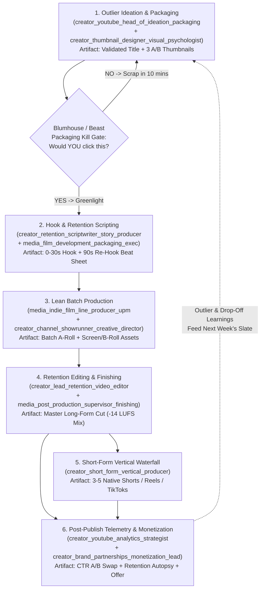
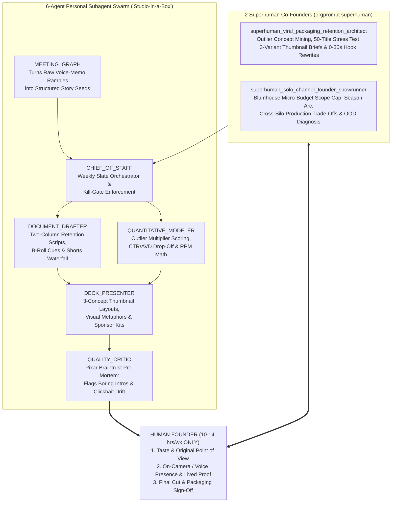

# The "Army of One to Boutique Studio" Social Media & YouTube Channel Launch Playbook

> [!IMPORTANT]
> **Executive North Star**: You do **not** need a 50-person crew, a `\$250,000` cinema camera package, or `60` hours a week of soul-crushing editing to build an enduring media property. By combining the **invariant laws of high-ROIC storytelling** (stolen directly from `Beast Industries / MrBeast`, `A24`, `Blumhouse Productions`, `Mythical Entertainment`, `Corridor Digital`, and `Kurzgesagt`) with your **6-Agent AI Subagent Swarm ("Studio-in-a-Box")** in `data/org_knowledge_base.db`, a single human founder can operate with the creative rigor, packaging discipline, and multi-platform output of a **10-person production company in `<10–15` hours per week**—spending human energy strictly on **Taste, On-Camera/Voice Presence, and Final Cut Judgment**.

---

## 1. How Production Organizations Actually Work Across 4 Scale Tiers

When beginners try to start a YouTube channel or social media brand, they make one of two fatal mistakes: either they **imitate Hollywood bloat** (spending weeks over-producing an unvalidated idea nobody clicks on) or they **wing it without a production system** (burning out by Video #7).

Examining production organizations across four orders of magnitude in our Organizational Knowledge Graph reveals a striking structural truth: **90% of big-studio headcount exists to manage coordination overhead and financial risk—not to put better story beats on screen.**

### Side-by-Side Operating Model Comparison Across 4 Scale Tiers

| Dimension | Tier 1: Major Conglomerates (`Disney`, `Pixar`, `Netflix`) | Tier 2: High-ROIC Indie Film (`A24`, `Blumhouse Productions`) | Tier 3: Scaled YouTube Machines (`Beast Industries`, `Mythical`) | Tier 4: Boutique & Solo Outfits (`Corridor Digital`, `Kurzgesagt`, `1–3` Person Channels) |
| :--- | :--- | :--- | :--- | :--- |
| **Typical Headcount** | `5,000–50,000+` enterprise employees (`200–800` crew per tentpole) | `50–250` corporate staff (`30–75` lean physical unit crew per film) | `80–300` full-time creators, producers, editors, thumbnail artists & dubbers | `1–25` multi-hyphenate generalists + specialized freelancers + AI Subagent Swarms |
| **Per-Project Budget** | `\$100M–\$250M+` per feature or flagship streaming season | `\$3M–\$15M` strict micro-budget cap (`Blumhouse`) or auteur mid-cap (`A24`) | `\$15K–\$100K` serialized studio batch (`Mythical`) to `\$1M–\$4M+` spectacle (`MrBeast`) | `\$0–\$500` (Solo Channel) up to `\$5K–\$25K` (`Corridor` / `Kurzgesagt` sponsorship-backed) |
| **Greenlight Gate** | 12–24 month multi-VP committee, quadrant market research & IP mandate | **Concept + Poster/Trailer + Budget Cap** (`Blumhouse`) or **Distinctive Director Voice** (`A24`) | **Title + 3 Thumbnails + Outlier Demand Proof BEFORE a single word is scripted** | **Founder Curiosity + Outlier Packaging Check** ("Would *I* click this alongside 10 competitors?") |
| **Production Cadence** | `2–5 years` per tentpole release | `8–14 months` end-to-end (`18–25` shooting days in 1–2 controlled locations) | `1–5x/week` via multi-episode batch studio shoot days (`Mythical`) or parallel pods (`Beast`) | `1x/week` (or biweekly high-polish) via fixed calendar blocks & reusable NLE templates |
| **Feedback Loop Latency** | Opening weekend box office / 28-day streaming cohort (`years` after greenlight) | Festival buzz, social trailer velocity & theatrical per-screen average (`months`) | **Real-time minute-by-minute telemetry**: `T+15m` CTR, `Test & Compare` A/B thumbnails, `0–30s` retention | **Immediate**: `T+2h` CTR check, `T+24h` retention graph forensics, comments & community signal |
| **Monetization Engine** | Box office, SVOD subscriptions, theme parks, licensing & theatrical windows | Low break-even theatrical + SVOD licensing + direct fan clubs (`AAA24` zines/merch) | AdSense RPM + 7-figure brand integrations + retail CPG (`Feastables`) + `Mythical Society` | AdSense RPM + targeted high-CPM sponsorships + digital products, cohorts, SaaS & community |


### What a Solo Founder Should Steal From Every Archetype

1. **Steal from `Beast Industries (MrBeast)` — *Packaging Before Production & 0–30s Retention Physics***:
   - Never write a script first. Design the **Title and 3 distinct Thumbnail concepts** before writing line one. If you cannot articulate an undeniable curiosity gap in `<= 50` characters and one glanceable visual frame, kill the idea immediately—saving `20` hours of wasted production.
   - Deliver **instant proof of the premise in seconds `0:00–0:05`**. Eliminate logos, throat-clearing (*"Hey guys, welcome back to the channel..."*), and backstory.
2. **Steal from `Blumhouse Productions` — *The Micro-Budget Cap & Single-Location Constraint***:
   - Jason Blum proved that capping budgets (`<\$5M` in film; `<\$50` and `1` room/desk setup for a solo creator) buys **total creative freedom**. Restrict your setup to a permanently lit "zero-friction corner" so pressing Record takes `<90` seconds, and put all energy into tension, ideas, and stakes rather than gear.
3. **Steal from `A24` — *Unmistakable Aesthetic Identity & Direct Superfan Monetization (`AAA24`)***:
   - Generic content dies in an AI-flooded feed. Pick a recognizable visual palette, recurring typography, and an unapologetic point of view. Monetize depth of fandom (newsletters, templates, memberships, artifacts) rather than relying solely on mass AdSense views.
4. **Steal from `Mythical Entertainment (Good Mythical Morning)` — *Serialized Formats & Batch Shooting***:
   - Invent **2–3 repeatable show formats** ("buckets") instead of reinventing the wheel every Tuesday. Batch-record 2–4 videos or voiceovers in a single high-energy block so you aren't context-switching between lighting/camera setup and deep writing on the same day.
5. **Steal from `Corridor Digital` — *Unified NLE + AI Acceleration & "Behind-the-Curtain" Storytelling***:
   - Standardize on one fast post-production hub (`DaVinci Resolve` or `Premiere Pro` + `Descript`) with pre-built sound/caption presets, and turn your *process* (experiments, failures, builds) into compelling human narrative.
6. **Steal from `Kurzgesagt – In a Nutshell` — *Research Depth & Visual Metaphor Clarity***:
   - Respect your audience's intelligence. Distill complex topics through concrete visual metaphors, structured multi-draft scripting, and cited primary sources so every video compounds evergreen search and suggested-feed trust for years.

---

## 2. The Creator Knowledge Graph: The 12 Core Roles & Artifact Handoff Pipeline

Inside `data/org_knowledge_base.db`, Phase 14 models the complete modern film and creator-economy value chain across **12 canonical roles**. Whether you are a 200-person studio where 12 specialists sit in separate Slack channels, or a **1-person founder** wearing the Showrunner hat while delegating the other hats to AI subagents, **the underlying DAG of artifacts is identical**.



### The 12 Canonical Roles in `org_knowledge_base.db` & Their Handoff Contracts

| # | Canonical Role Slug | Studio / Creator Function | Primary Metric Owned | Core Output Artifact Handed Downstream |
| :-: | :--- | :--- | :--- | :--- |
| 1 | `creator_youtube_head_of_ideation_packaging` | Outlier Demand Mining & Premise Framing | **Click-Through Rate (`CTR`)** & Total Addressable Topic Demand | `Greenlit Concept Brief` (`1` Winning Title + `2` Alts + Curiosity Gap Thesis) |
| 2 | `creator_thumbnail_designer_visual_psychologist` | Visual Composition, Gaze Flow & A/B Packaging | **Browse/Suggested `CTR`** & Watch-Time-Weighted Test Share | `3 Distinct Thumbnail Variants` (`A/B/C` PNGs verified at mobile `168x94px` scale) |
| 3 | `creator_retention_scriptwriter_story_producer` | `0–30s` Hook Engineering, Open Loops & Payoffs | **`0–30s` Retention (`>=70%`)** & **Average View Percentage (`AVP`)** | `Two-Column Retention Script` (Spoken Audio + Visual Beat/B-Roll Cues every `4–8s`) |
| 4 | `media_film_development_packaging_exec` | Narrative Structure, Genre Tension & Coverage | **Story Arc Satisfaction** & Share/Comment Velocity | `Story Coverage & Structural Beat Audit` (eliminating sagging Act II middles) |
| 5 | `media_indie_film_line_producer_upm` | Micro-Budget Scope Control & Batch Scheduling | **Cost-per-Published-Minute** & Shoot-Day Throughput | `Zero-Friction Batch Run-of-Show` (Shot List, Props, Lighting & Asset Checklist) |
| 6 | `creator_channel_showrunner_creative_director` | Voice Consistency, Slate Balance & Final Gate | **Returning Viewer Ratio** & Channel Brand Equity | `Season Format Bible` & Final Greenlight / Final Cut Sign-Off |
| 7 | `creator_lead_retention_video_editor` | Rhythm, `J-Cuts`, Pattern Interrupts & Sound | **Average View Duration (`AVD`)** & Slope Flatness (`Min 1 -> End`) | `Retention-Locked Master Picture Cut` (zero dead air, visual resets every `60–90s`) |
| 8 | `media_post_production_supervisor_finishing` | Color Consistency, Dialogue Clarity & QC | **Audio Intelligibility (`-14 LUFS`)** & Zero Technical Rejects | `Broadcast/Platform-Ready Master Export` + Reusable NLE Project Archive |
| 9 | `creator_short_form_vertical_producer` | `9:16` Hook Re-framing & Multi-Platform Waterfall | **Swipe-Through Rate (`>75%` Stayed to Watch)** & Discovery Reach | `3–5 Standalone Vertical Cuts` (`Shorts`, `Reels`, `TikTok`) with native hooks |
| 10 | `creator_youtube_analytics_strategist` | `Test & Compare` A/B Loops & Drop-Off Forensics | **Impressions Velocity** & Cohort Watch-Time Compounding | `T+24h / T+7d Retention Autopsy` + Next-Slate Packaging Prescriptions |
| 11 | `creator_brand_partnerships_monetization_lead` | Sponsorships, Digital Products & Community | **Effective Revenue Per Mille (`eRPM`)** & Customer LTV | `Media Kit`, Native `45s` Ad-Read Integration & Owned Funnel Offer |
| 12 | `creator_solo_founder_one_person_media_studio` | AI-Augmented Solo Founder Operating System | **Revenue & Audience Growth per Human Hour (`<15 hrs/wk`)** | End-to-End Weekly Published Long-Form + Short-Form Waterfall |

### Tactical Benchmarks by Niche & The `Test & Compare` Diagnostic Matrix

Never judge your channel against generic platform averages—a `5%` CTR in high-RPM B2B/Finance can outperform an `11%` CTR in gaming by `8x` in revenue. Anchor your expectations to your vertical:

| Niche / Vertical | Healthy Browse `CTR` | Elite `0–30s` Retention | Target `AVP` (`10–18m` video) | Typical Long-Form AdSense `RPM` | Primary Non-AdSense Multiplier (`3x–10x` AdSense) |
| :--- | :---: | :---: | :---: | :---: | :--- |
| **Finance, Investing & B2B SaaS** | `4.5% – 7.0%` | `>= 70%` | `42% – 55%` | `\$12.00 – \$30.00+` | High-ticket software affiliates, advisory, cohorts & newsletters |
| **AI, Coding & Tech Engineering** | `5.5% – 8.5%` | `>= 68%` | `40% – 52%` | `\$6.00 – \$14.00` | Developer tool sponsorships (`\$35–\$60 CPM`), templates & SaaS |
| **Science & Deep Edutainment (`Kurzgesagt` style)** | `5.0% – 8.0%` | `>= 72%` | `48% – 62%` | `\$4.00 – \$9.00` | Annual sponsor integrations, physical posters/merch & Patreon |
| **Filmmaking, Design & Creative Craft (`Corridor`)** | `6.0% – 9.5%` | `>= 65%` | `38% – 50%` | `\$4.00 – \$8.50` | Asset packs, LUTs/presets, courses & studio memberships |
| **Health, Fitness & Performance** | `6.5% – 10.0%` | `>= 65%` | `40% – 50%` | `\$3.00 – \$7.50` | Coaching programs, supplements, apps & digital protocols |
| **Broad Entertainment, Challenges & Vlogs** | `7.5% – 13.0%` | `>= 65%` | `35% – 48%` | `\$2.00 – \$5.50` | Mass-market brand deals, CPG products & live events |

> [!TIP]
> **How YouTube Studio `Thumbnail Test & Compare` Actually Picks Winners**: YouTube does **not** crown the thumbnail with the highest raw click-through rate; it crowns the variant that generates the highest **Watch-Time Share per Impression**. If Thumbnail A gets a `10%` CTR via exaggerated clickbait that causes `60%` of viewers to bounce in the first `20` seconds, it will **lose** to Thumbnail B with a `6.8%` CTR whose viewers stay for `55%` of the video. Always upload **3 genuinely distinct visual hypotheses** (e.g., *Variant A*: Human Face + Visceral Emotion; *Variant B*: Clean Object/Result Comparison Split-Screen; *Variant C*: Curiosity Diagram / Extreme Scale Contrast)—never three minor font-color tweaks.

#### Anatomy of a High-Retention Video Timeline (`0:00` to End Screen)

- **`0:00 – 0:05` (Proof of Promise)**: Visually and verbally confirm the viewer clicked the right video in the very first sentence. Show the finished build, the stakes on the table, or the counterintuitive anomaly *immediately*. Zero channel intros, zero *"Before we dive in..."*.
- **`0:05 – 0:30` (Stakes + Open Curiosity Loop)**: Establish **what is at risk**, **what constraints apply**, and **the central unanswered question** that can only be resolved by watching Act III. Aim for `>= 70%` of viewers still watching at `0:30`.
- **`0:30 – Minute 3:00` (Progressive Escalation & `60–90s` Re-Hooks)**: Structure scripts as **But / Therefore** causal chains (stolen from *South Park* & *Pixar*), never *"And then... and then..."* lists. Close one micro-loop every `60–90` seconds while opening the next.
- **`Minute 3:00` (The Mid-Video Pattern Interrupt)**: Attention naturally decays around `2:45–3:30`. Script a deliberate **state change**: shift camera framing/location, introduce a live demo or physical prop, drop the background music completely for `3` seconds before a twist, or raise the stakes.
- **Final `15` Seconds (Zero "Outro Signal" Binge Bridge)**: Never say *"Well guys, that wraps up today's video!"*—that phrase triggers an instant `40%+` cliff drop-off. End on your final insight and immediately open a new curiosity gap pointing directly to **one specific next video** on the End Screen (*"Solving X created an even weirder problem with Y—watch how I fixed it right here"*).

---

## 3. Starting as an Army of One: Your "Studio-in-a-Box" AI Subagent Swarm

Most solo creators burn out because they spend `85%` of their hours on **undifferentiated mechanical labor** (scraping competitor titles, formatting beat sheets, removing "ums/ahs" from transcripts, hunting timestamps for Shorts, building sponsor media kits) and only `15%` on what audiences actually care about.

Your Phase 14 database wires **`creator_solo_founder_one_person_media_studio`** alongside two purpose-built **Polymathic Superhuman Roles**—**`superhuman_solo_channel_founder_showrunner`** and **`superhuman_viral_packaging_retention_architect`**—so that **one human + a 6-agent Personal Subagent Swarm** compresses a `45`-hour studio week into **`10–14` high-leverage human hours**.



### Dual-Layer Creator Tooling Stack & Weekly Human-vs-AI Time Budget (`12.5 hrs/wk` Total)

| Workflow Stage | Horizontal Productivity Layer | Vertical Creator / Film Layer (`tools` table) | What Your AI Swarm Executes (`~80%` Offload) | What **YOU** Do as Human Showrunner (`12.5 hrs/wk`) |
| :--- | :--- | :--- | :--- | :--- |
| **1. Outlier Ideation & Packaging** | `Google Sheets` + `Slides / Canva` | `youtube_studio_analytics` (*YouTube Studio Analytics & Thumbnail Test-and-Compare*) | Scores `30` adjacent-niche outlier videos (`Views / Channel Avg >= 3.0x`), drafts `50` titles, and specs `3` high-contrast thumbnail layouts | **Pick the `1` idea that excites you** + shoot `3` expressive thumbnail stills (`1.5 hrs`) |
| **2. Research & Retention Scripting** | `Voice Memo / Notes` + `Google Docs / Notion` | `studiobinder_moviemagic` (*StudioBinder & Movie Magic Budgeting / Scheduling*) | Transcribes your `15m` walk-and-talk voice memo, verifies primary sources, drafts `3` `0–30s` hooks, and formats the 2-column A/B-roll beat sheet | **Inject lived stories, contrarian taste & read-aloud rhythm pass** (`2.5 hrs`) |
| **3. Lean Batch Filming** | `Checklist / Teleprompter` | Permanently lit 1-corner camera/mic rig + screen recorder | Generates prop/screen-demo checklist and concise bullet-point teleprompter cues (so you don't sound robotic) | **Deliver high-energy on-camera / voice performance** (`2.5 hrs`) |
| **4. Rough Cut -> Fine Retention Cut** | `Docs` Paper-Edit | `frameio_descript_clipper` + `davinci_premiere_nle` (*DaVinci Resolve / Premiere Pro*) | Auto-strips dead air, retakes & filler words in `Descript`, exports XML timeline to `DaVinci Resolve`, and proposes B-roll/SFX markers | **Sculpt pacing, `0–30s` hook energy, music transitions & Final QC** (`4.0 hrs`) |
| **5. Short-Form Waterfall (`3–5` Clips)** | `Notion` Content Calendar | `frameio_descript_clipper` (*Frame.io, Descript & Short-Form AI Clipping Suite*) | Extracts top `5` self-contained emotional/insight peaks, rewrites `0–2s` vertical hooks, and auto-reframes `9:16` captions | **Approve top `3` vertical cuts & post natively** (`1.0 hr`) |
| **6. Telemetry & Monetization** | `Sheets` Cohort Tracker + `Email` | `youtube_studio_analytics` (`Test & Compare` + Retention Curve) | Runs `T+24h` retention drop-off diagnosis, tracks `Test & Compare` watch-time winner, and drafts sponsor/newsletter copy | **Swap losing packaging if `CTR < target` & reply to top `20` comments** (`1.0 hr`) |

---

## 4. The Creator Hiring Ladder (When & Who to Hire as Revenue Grows)

Following the empirical **Colin & Samir / Creator-Economy Hiring Ladder**, **never hire ahead of predictable monthly revenue**, and never outsource your *voice* or *audience intuition* before you outsource *mechanical timeline hours*. Every human hire simply takes over one of the canonical role boxes your AI Subagent Swarm was already holding warm—meaning you hand your new hire an instant, battle-tested SOP!

### The 4-Stage Revenue-Gated Creator Hiring Ladder

| Stage | Audience & Monthly Revenue Floor | Team Composition | Exact Role(s) to Hire Next (`canonical_roles` Slug) | Typical Compensation Structure | Hours Reclaimed & Strategic Unlock |
| :--- | :--- | :--- | :--- | :--- | :--- |
| **Stage 0: Format-Market Fit** | `0 – 1,000` subs<br>`\$0 – \$1,000/mo` | **1 Human Founder + 6-Agent AI Swarm** (`creator_solo_founder_one_person_media_studio`) | **Hire Nobody.** Zero payroll overhead gives you infinite runway to ship `20–30` reps and discover your winning format. | `\$0/mo` payroll (`\$30–\$80/mo` software stack) | You learn editing rhythm, hook physics, and packaging firsthand so no future freelancer can bluff you. |
| **Stage 1: Buy Back Timeline Hours** | `1,000 – 25,000` subs<br>`\$1,500 – \$5,000/mo` | Founder + **Hire #1: Freelance Retention Video Editor** | `creator_lead_retention_video_editor` | `\$300 – \$800` per long-form video (`\$1,200 – \$3,000/mo` part-time retainer) | **Reclaims `15–25 hrs/video`**. Reinvest `100%` of saved hours into 2x better packaging, deeper research, and pitching first sponsors. |
| **Stage 2: The Specialist Creative Pod** | `25,000 – 100,000` subs<br>`\$5,000 – \$25,000/mo` | Founder + Editor + **Hire #2 (Thumbnail Specialist) & Hire #3 (Research / Shorts Producer)** | `creator_thumbnail_designer_visual_psychologist`<br>+ `creator_short_form_vertical_producer` (or `creator_retention_scriptwriter_story_producer`) | Thumbnail: `\$75–\$250` per 3-pack<br>Producer/Shorts: `\$1,500–\$4,000/mo` | **Lifts Browse `CTR` by `+1.5%–3.0%`** (often doubling views on the exact same video) + turns 1 long-form shoot into `15+` multi-platform assets/mo. |
| **Stage 3: Boutique 5–12 Person Studio** | `100,000 – 1M+` subs<br>`\$25,000 – \$150,000+/mo` | `Corridor Digital` / `Kurzgesagt` Pod Model (`5–12` specialists) | `creator_channel_showrunner_creative_director`<br>+ `creator_brand_partnerships_monetization_lead`<br>+ `creator_youtube_analytics_strategist` | Full-time studio pod + `%` commission / performance bonus on sponsorships & owned products | Founder elevates to Executive Talent & Creative Director; studio runs overlapping production pipelines, `\$50K+` brand deals, and owned IP/products. |

> [!WARNING]
> **Three Hiring Anti-Patterns That Bankrupt Growing Channels**:
> 1. **Hiring a Short-Form Clipper Before Fixing Long-Form Packaging**: Repurposing mediocre long-form videos into `30` mediocre Shorts generates vanity views with near-zero subscriber loyalty or RPM. Fix your long-form `Title + Thumbnail + 0–30s Hook` first.
> 2. **Signing a Full-Time Editor Without a Paid 60-Second Trial Cut**: Never hire off a polished portfolio reel alone (you don't know if that 10-minute reel took them `6` hours or `60` hours). Pay `3` finalists `\$100–\$150` each to edit the **exact same `90`-second raw A-roll hook** from your channel within `48` hours.
> 3. **Abdicating Packaging Too Early**: Even at `1M+` subscribers (`Beast Industries` & `Mythical`), the founder/showrunner stays intimately involved in greenlighting Titles and Thumbnails. Outsource *execution* of thumbnails in Stage 2, never *ownership* of the premise.

---

## 5. Weekly Production Operating System & Quality Gates (The Anti-Burnout Cadence)

Consistency on YouTube and social media is an **engineering scheduling problem, not a willpower problem**. Below is a battle-tested weekly cadence designed to fit cleanly alongside a demanding day job or company (`~12.5` hours/week), plus a 2x/month batch option inspired by `Mythical Entertainment`.

### The Anti-Burnout Weekly Schedule (`1` High-Signal Long-Form + `3` Vertical Cuts / Week)

| Day | Block Duration | Mode (Never Mix Modes!) | Concrete Deliverable Completed |
| :--- | :---: | :--- | :--- |
| **Monday (Eve)** | `1.5 hrs` | **Strategist Mode** (*Ideation & Packaging*) | Run `superhuman_viral_packaging_retention_architect` on 5 seed ideas -> Pass **Gate 1 (Kill Gate)** -> Lock `1` Title + `3` Thumbnail sketches. |
| **Tuesday (Eve)** | `2.0 hrs` | **Writer Mode** (*Hook & Beat Scripting*) | Record `15m` raw voice-memo braindump -> AI Swarm drafts 2-column script -> Rewrite `0–30s` hook (`3` versions) -> Pass **Gate 2 (Read-Aloud)**. |
| **Wednesday (Eve)** | `0.5 hrs` | **Line Producer Mode** (*Zero-Friction Prep*) | Capture screen recordings, code demos, charts, or B-roll assets; stage props and teleprompter bullets so Saturday shoot has zero friction. |
| **Thursday / Friday** | `0.0 hrs` | **Protected Rest / Deep Life Input** | **Zero production.** Live interesting experiences, build projects, read primary papers—raw material for original Taste. |
| **Saturday (Morn)** | `3.0 hrs` | **Performer Mode** (*Batch Shoot + Stills*) | Shoot expressive Thumbnail Stills *first* while energy is peak (`20m`), then batch-record A-roll (`1–2` episodes back-to-back while lit). |
| **Sunday (Morn)** | `4.5 hrs` | **Editor & Showrunner Mode** (*Cut + Waterfall*) | `Descript` transcript rough-cut (`30m`) -> `DaVinci Resolve` pacing, `J-cuts`, B-roll & `-14 LUFS` sound pass (`3h`) -> Export `3` vertical clips + schedule `Test & Compare` (`1h`). |
| **Publish + 24h** | `1.0 hr` | **Telemetry Mode** (*Post-Publish Loop*) | Pin curiosity-extending top comment, reply to early superfans, check `T+2h` CTR & `T+24h` `0–30s` retention curve, log 1 lesson for Monday. |

### The 4 Non-Negotiable Studio Quality Gates

1. **Gate 1 — The Blumhouse / MrBeast Packaging Kill Gate (Monday)**: Mock up your Title and primary Thumbnail inside a screenshot of the real YouTube Home feed surrounded by top creators in your niche (at both desktop and `168x94px` mobile size). Ask: *"If I didn't know me, would I stop scrolling and click this right now?"* If no, **kill or re-angle before writing a word**.
2. **Gate 2 — The `0–30s` Table-Read Stopwatch Gate (Tuesday)**: Read the first `75–85` words out loud with a stopwatch. Have you visually proven the thumbnail promise by `0:05` and opened an irreversible curiosity loop by `0:25` without a single wasted throat-clearing clause?
3. **Gate 3 — The "Mute + Commute" Dual Sensory Gate (Sunday)**:
   - *Watch the first `90` seconds completely ON MUTE*: Does the visual story change every `4–8` seconds so a viewer in a noisy cafe stays hooked?
   - *Listen to `3` random minutes EYES CLOSED*: Is the vocal crisp, `-14 LUFS` balanced over music (`-24` to `-28 LUFS` bed), with zero awkward `1.5s` dead pauses?
4. **Gate 4 — The `T+24h` Single-Variable Retrospective**: Never diagnose "the algorithm hates me." Check two numbers only:
   - `CTR < Niche Floor`? Keep the video philosophy, **swap Thumbnail/Title** via `Test & Compare`.
   - `0–30s Retention < 60%`? Your opening `15` seconds mismatched the thumbnail promise or dragged; cut straight to the action in Video `N+1`.

### Your 30-Video Launch Roadmap (`Format-Market Fit` in 6 Months)

- **Phase I: Videos `1 – 10` (*Kill Perfectionism & Build Pipeline Muscle*)**:
  - **Goal**: Ship `10` complete episodes on schedule without missing a week. Ignore subscriber count completely.
  - **Rule**: Change **one concrete craft lever per video** (Video 2: crisp audio; Video 3: `0–5s` cold open; Video 4: 3-concept thumbnails; Video 5: `J-cuts` & music drops; Video 6: visual metaphor B-roll).
- **Phase II: Videos `11 – 20` (*Outlier Experimentation & Bucket Discovery*)**:
  - **Goal**: Test **3 distinct content formats ("buckets")** (`3–4` videos per bucket)—for example: (A) *Deep Breakdown / Case Study*, (B) *Build / Experiment Challenge*, (C) *Contrarian Industry Myth-Bust*.
  - **Signal to Watch**: Look for your **first `2x–5x` channel-outlier video** where *Non-Subscriber Browse/Suggested Impressions* spike alongside `>= 65%` `0–30s` retention.
- **Phase III: Videos `21 – 30` (*Format Lock, Monetization Wedge & Hire #1 Readiness*)**:
  - **Goal**: Double down `70%` of your slate on the winning format bucket (`20%` adjacent iteration, `10%` wildcards). Launch your **owned capture wedge** (high-value newsletter, free template/code repo, or community waitlist in the description + pinned comment) so you monetize at `5,000` true fans instead of waiting for `500,000` AdSense views.

---

## 6. Ready-to-Run CLI Commands & Prompts in Your Database

Everything in this playbook is wired directly into your local Organizational Knowledge Graph (`data/org_knowledge_base.db`). Run these commands right now from `/home/pakmingw/.gemini/antigravity/scratch/org_meta_prompt_db` to scaffold runbooks, inspect studio blueprints, or launch your Superhuman Packaging & Showrunner agents for **Video #1**:

### A. Search Creator, Indie Film & Retention Roles via Hybrid Search (`BM25 + Dense LSA`)
```bash
python3 -m orgprompt.cli search query "YouTube thumbnail CTR retention video editor" --top-k 5
python3 -m orgprompt.cli search query "indie film line producer micro-budget" --top-k 5
python3 -m orgprompt.cli search query "solo creator social media channel" --top-k 5
```

### B. Scaffold Your "One-Person AI Studio" Runbook & Your Future Hire #1 Editor SOP
```bash
# 1. Export your complete Solo Founder 6-Agent Swarm & Dual-Layer Tooling Runbook
python3 -m orgprompt.cli scaffold role creator_solo_founder_one_person_media_studio \
  --output artifacts/runbooks/my_solo_studio_runbook.md

# 2. Export a turn-key onboarding SOP for when you hire your first Freelance Video Editor (Stage 1)
python3 -m orgprompt.cli scaffold role creator_lead_retention_video_editor \
  --company "Beast Industries" \
  --output artifacts/runbooks/first_editor_hire_sop.md
```

### C. Scaffold Operating Models of Onboarded Studios (`Beast Industries`, `A24`, `Blumhouse`, `Corridor`, `Kurzgesagt`, `Mythical`)
```bash
python3 -m orgprompt.cli scaffold company "Beast Industries" --problem "Maximize Browse CTR and 0-30s retention across weekly tentpole uploads"
python3 -m orgprompt.cli scaffold company "Blumhouse Productions" --problem "Enforce micro-budget concept validation before principal photography"
python3 -m orgprompt.cli scaffold company "Corridor Digital" --problem "Scale a 15-person multi-channel VFX and behind-the-scenes creator pipeline"
python3 -m orgprompt.cli scaffold company "Kurzgesagt" --problem "Translate primary scientific research into high-retention visual metaphors"
```

### D. Inspect Your Pre-Built Creator Superhuman Profiles—or Synthesize a Custom One for Video #1!
```bash
# List and inspect the 2 persisted Creator Superhuman Profiles (30,000+ char 8-section deep prompts)
python3 -m orgprompt.cli superhuman list
python3 -m orgprompt.cli superhuman inspect superhuman_solo_channel_founder_showrunner
python3 -m orgprompt.cli superhuman inspect superhuman_viral_packaging_retention_architect

# Synthesize a bespoke Superhuman Showrunner tailored to YOUR exact channel niche & Video #1 idea:
python3 -m orgprompt.cli superhuman synthesize \
  --role creator_solo_founder_one_person_media_studio \
  --problem "Design my first 10-video slate, 3 repeatable show formats, and Video #1 Title + 3 Thumbnails + 0-30s Hook" \
  --developer-context "Solo technical founder working 12 hrs/week; niche: applied AI engineering & how real organizations work; goal: high-trust B2B/builder audience + owned newsletter" \
  --adjacent-k 6 \
  --output artifacts/superhuman_roles/my_channel_episode_1_architect.md
```
